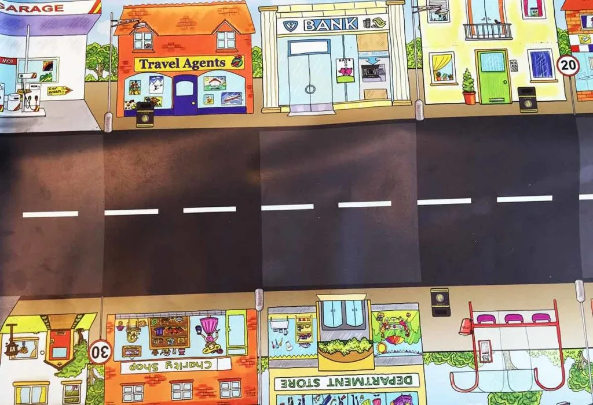

## Material

Bee-Bots, valfri Bee-bot-vänlig matta och dina bästa läroplansglasögon. Det fungerar givetvis med andra liknande RoBotar istället för just Bee-bot.

Valfritt - [Ladda ned PDF med symbolerna i A4-storlek](/media/doc/Beebot-Kommandon-PDF.pdf) om du vill skriva ut och använda.

## Hur funkar en Bee-Bot? {.steg}

Börja med att visa eleverna hur en Bee-bot fungerar och vilka instruktioner vi kan ge den. Tänk på att försöka använda "rätt språk" redan från början, som att Bee-bot roterar - inte svänger.
Låt dem sedan testa några minuter att programmera Bee-bot och visa på hur de rensar koden.

## Kör från garaget {.steg}

#### Uppgift [A]

Eleverna jobbar parvis i denna uppgift.
**Elevernas Bee-bot Kim är parkerad i garaget och den vill åka till busshållplatsen i den lilla staden Robotonia.**
Vi vill att eleverna;
1. tänker ut en färdväg,
2. diskuterar färdvägen och
3. försöker visualisera koden innan de programmerar den.
Om det blir fel, låt eleverna felsöka genom att diskutera och hitta felet innan de försöker igen. Detta för att undvika att endast prova sig fram.

:::fakta
begrepp: Stegvisa Instruktioner, Felsökning
fokus: Stegvisa instruktioner | Vad är kod?
ålder: Åk 0, Åk 1
:::

#### Uppgift [B]

Eleverna jobbar parvis i denna uppgift.
**Elevernas Bee-bot Kim är parkerad i garaget i den lilla staden Robotonia och den vill åka till banken för att hämta ut lite pengar.  Dock måste Bee-bot backa in till banken.**
Vi vill att eleverna;
1. tänker ut en färdväg,
2. diskuterar färdvägen och
3. försöker visualisera koden innan de programmerar den.
Om det blir fel, låt eleverna felsöka genom att diskutera och hitta felet innan de försöker igen. Detta för att undvika att endast prova sig fram.

:::fakta
begrepp: Stegvisa Instruktioner, Felsökning
fokus: Stegvisa instruktioner | Vad är kod?
ålder: Åk 0, Åk 1
:::

#### Uppgift [C]

Eleverna jobbar parvis i denna uppgift.
**Elevernas Bee-bot Kim är parkerad i garaget och först vill den åka till busshållplatsen för att hämta upp en kompis. Därefter vill de till banken för att hämta ut lite pengar.  Dock måste Bee-bot backa in till banken.**
Vi vill att eleverna;
1. tänker ut en färdväg,
2. diskuterar färdvägen och
3. försöker visualisera koden innan de programmerar den.
Om det blir fel, låt eleverna felsöka genom att diskutera och hitta felet innan de försöker igen. Detta för att undvika att endast prova sig fram.

:::fakta
begrepp: Stegvisa Instruktioner, Felsökning
fokus: Stegvisa instruktioner | Vad är kod?
ålder: Åk 0, Åk 1
:::
