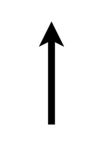
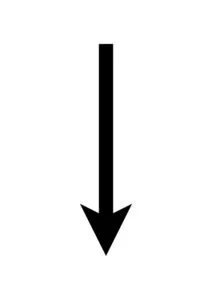
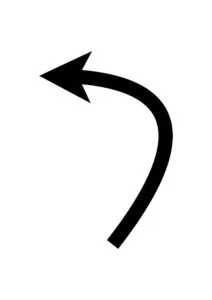
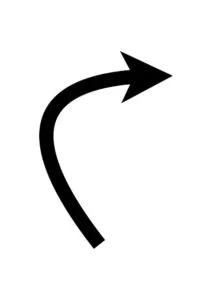
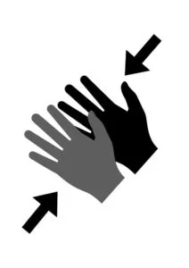
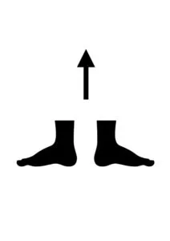
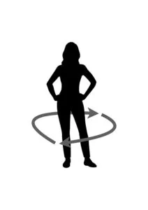
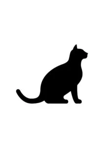

## Material

Denna övning är analog, så vi behöver bara varandra, penna och papper samt lite bra musik att dansa till.
Ladda ned danssymbolerna som PDF för att skriva ut | [Hoppa](/media/doc/hoppa.pdf) - [Klappa händerna](/media/doc/klappa-handerna.pdf) - [Snurra runt](/media/doc/snurra-runt.pdf) - [Jama som en katt](/media/doc/jama.pdf)

## Programmera en robotkompis {.steg}

#### Uppgift [A] - Ta dig till dörren

Eleverna jobbar parvis eller fler i denna uppgift och turas om vem som ska programmera och vem som ska programmeras.
**Din robot kan bara fyra saker; gå framåt, gå bakåt, rotera till höger (90 grader) och rotera till vänster (90 grader). Nu måste du programmera roboten så att den går till dörren (B) från startpunkten (A).**

****

Du som lärare sätter ut en startpunkt för robotarna att börja från. Nu vill vi att eleven / eleverna som ska programmera roboten;
1. tänker ut en färdväg mellan A och B,
2. diskuterar färdvägen och
3. skriver ned koden med de symboler vi använder ovan för färdvägen.
4. Nu får roboten (den som ska programmeras) titta på koden och utföra **exakt** det som står där.

Be eleverna testa sin kod medans de jobbar med den. Diskutera kring vad som kan gå fel? Är ett steg lika långt för alla? Om det blir fel, låt eleverna felsöka genom att diskutera och hitta felet innan de försöker igen.

:::fakta
begrepp: Stegvisa Instruktioner, Symbolers användning, Felsökning
fokus: Symbolers användning | Att skriva kod och förstå kopplingen mellan skriven kod och hur den kan användas
ålder: Åk 0, Åk 1
:::

## Dansprogrammering {.steg}

#### Uppgift [A]

**Nu är det dags för fest och det ska dansas. Men hur får man en hel klass att dansa samma dans och göra samma rörelser?**
Du som lärare börjar med att skapa en dans på 8 instruktioner utifrån dessa symboler (eller egna) och sätter upp dem på tavlan. Låt hela klassen dansa. Instruktionerna utförs på varje taktslag i musiken, eller det ni kommer överrens om. De 8 instruktionerna upprepas om och om igen tills att du tycker att dansen är slut.

Klappa händerna

Hoppa

Snurra runt

Jama som en katt

Ladda ned danssymbolerna som PDF för att skriva ut | [Hoppa](/media/doc/hoppa.pdf) - [Klappa händerna](/media/doc/klappa-handerna.pdf) - [Snurra runt](/media/doc/snurra-runt.pdf) - [Jama som en katt](/media/doc/jama.pdf)

:::fakta
begrepp: Stegvisa Instruktioner, Symbolers användning, Felsökning
fokus: Symbolers användning | Att skriva kod och förstå kopplingen mellan skriven kod och hur den kan användas
ålder: Åk 0, Åk 1
:::

#### Uppgift [B]

Eleverna jobbar parvis eller fler i denna uppgift.
**Nu vill vi att eleverna i sina grupper;**
1. Skapar en egen symbol för ett danssteg, exempelvis stamp i marken, lyft högerhand, skäll som en hund, skaka rumpan eller annat. Tänk dock på att det måste vara en entydig instruktion, inte flera instruktioner i en symbol.
2. Eleverna skapar en egen dans på 8 instruktioner som innehåller deras egna symbol.
3. Klassen testar att dansa.

:::fakta
begrepp: Stegvisa Instruktioner, Symbolers användning, Felsökning
fokus: Symbolers användning | Att skriva kod och förstå kopplingen mellan skriven kod och hur den kan användas
ålder: Åk 0, Åk 1
:::
