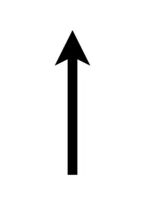
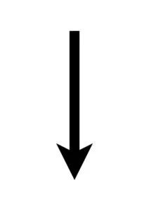
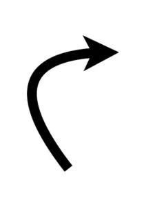
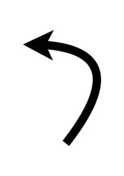
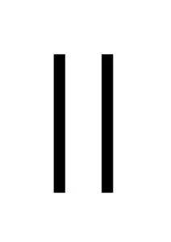

## Material

Bee-Bots, valfri Bee-bot-vänlig matta och dina bästa läroplansglasögon. Det fungerar givetvis med andra liknande RoBotar istället för just Bee-bot.
Valfritt - [Ladda ned PDF med symbolerna i A4-storlek](/media/doc/Beebot-Kommandon-PDF.pdf) om du vill skriva ut och använda.

## Skapa ett kodspråk baserat på symboler {.steg}

**Prata med eleverna om vad programmering / kod är för något. Börja gärna med att fråga dem om vad de tror att det är och varför det finns. Vad kan det vara bra för? Visa bilder på olika saker och fråga dem vad de tror är programmerat eller inte.**

Utgå från Bee-bot och vilka symboler som redan används. Kom tillsammans på regler för hur ni skriver kod för era Bee-bots och skapa ert egna kodspråk med hjälp av symboler.
När det gäller Bee-bots, vad beskriver bäst riktning? Upp, ned, framåt, bakåt, höger eller högerrotation? Vad passar bäst och vad beskriver instruktionerna bäst?

*I de kommande uppgifterna har vi kommit fram till vårt kodspråk, vilket använder de symboler som redan finns på Bee-bot (se symbolerna ovan). För att få Bee-bot att gå tre steg framåt använder vi oss av 3 pilar upp bredvid varandra och läses från vänster till höger.
Vill du ladda ned ovanstående symboler i A4-storlek som PDF för utskrift, [klicka här](/media/doc/Beebot-Kommandon-PDF.pdf).*

**Ett exempel på vikten av ett gemensamt korrekt språk är** exempelvis att säga högerrotation istället för att säga höger, eftersom det senare är felaktigt och kan få eleven att tro att Bee-bot går till höger om de klickar på den knappen. Diskutera detta tillsammans.

:::fakta
begrepp: Stegvisa Instruktioner, Symbolers användning
fokus: Symbolers användning | Att skriva kod
ålder: Åk 0, Åk 1
:::

## Skriv kod och byt med varandra {.steg}

#### Uppgift [A]

Eleverna jobbar parvis eller fler i denna uppgift.
**Låt paren eller grupperna välja en startpunkt på mattan (A) och ett mål där Bee-bot ska hamna (B).**
Nu vill vi att eleverna;
1. tänker ut en färdväg mellan A och B
2. diskuterar färdvägen och
3. skriver ned koden för färdvägen. Därefter får de testa om det funkar.
Om det blir fel, låt eleverna felsöka genom att diskutera och hitta felet innan de försöker igen.
4. Nu ska de dela koden med en annan grupp och bara berätta vad startpunkten är. Därefter får de se om den andra gruppen lyckas läsa deras kod och hamnar de ska.

:::fakta
begrepp: Stegvisa Instruktioner, Symbolers användning, Felsökning
fokus: Symbolers användning | Att skriva kod och förstå kopplingen mellan skriven kod och hur den kan användas
ålder: Åk 0, Åk 1
:::

#### Uppgift [B]

Eleverna jobbar parvis eller fler i denna uppgift.
**Här väljer du som lärare ut en startpunkt (A) och ett mål (B) på elevernas matta.**
**Diskutera om det finns något rätt eller fel i mycket eller lite kod? Vad kan problemen med mycket kod vara (exempelvis svårt att läsa eller större risk för fel med fler instruktioner)? Om två olika grupper löser samma problem, men den ena använder 10 instruktioner och den andra 20, är något mer rätt då?**

Nu vill vi att eleverna;
1. kommer på hur de kan skapa den kortaste koden (minst antal instruktioner) för att ta sig från plats A till B och skriver ned den
2. delar koden med en annan grupp och försöker programmera varandras kod för att se att det fungerar

Till sist tar du som lärare upp några olika elevlösningar. Hade de kommit fram till samma? Eller hade de hittat olika vägar?

:::fakta
begrepp: Stegvisa Instruktioner, Symbolers användning, Felsökning
fokus: Symbolers användning | Att skriva kod och förstå kopplingen mellan skriven kod och hur den kan användas
ålder: Åk 0, Åk 1
:::

#### Uppgift [C]

Eleverna jobbar parvis eller fler i denna uppgift.
**Här väljer du som lärare ut en startpunkt (A) och ett mål (B) på elevernas matta.**

Nu vill vi att eleverna;
1. skapar en färdväg som är exakt 10 instruktioner lång
2. skriver ned koden och byter med en annan grupp

Till sist tar du som lärare upp några olika elevlösningar. Hade de kommit fram till samma? Eller hade de hittat olika vägar?

:::fakta
begrepp: Stegvisa Instruktioner, Symbolers användning, Felsökning
fokus: Symbolers användning | Att skriva kod och förstå kopplingen mellan skriven kod och hur den kan användas
ålder: Åk 0, Åk 1
:::

#### Uppgift [D]

Eleverna jobbar parvis eller fler i denna uppgift.
**Här väljer du som lärare ut en startpunkt (A) och ett mål (B) på elevernas matta.**

Nu vill vi att eleverna;
1. skapar en färdväg som är exakt 12 instruktioner lång och måste avslutas med att Bee-Bot backar in i mål
2. skriver ned koden och byter med en annan grupp

Till sist tar du som lärare upp några olika elevlösningar. Hade de kommit fram till samma? Eller hade de hittat olika vägar?

:::fakta
begrepp: Stegvisa Instruktioner, Symbolers användning, Felsökning
fokus: Symbolers användning | Att skriva kod och förstå kopplingen mellan skriven kod och hur den kan användas
ålder: Åk 0, Åk 1
:::
