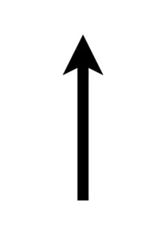
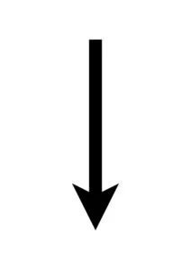
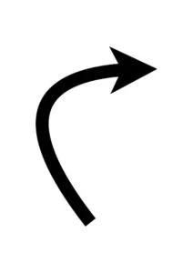
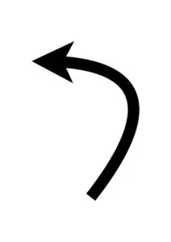

## Material

Penna, papper, Bee-Bots, tejp och dina bästa läroplansglasögon
**Mät ut (Bee-bot rör sig 15 cm på ett steg) och skapa en tallinje (från 0-10 med lite tejp och linjal) på golvet i klassrummet och låt Bee-bot starta på 0.**

## Bee-bot-instruktioner

Framåt, bakåt, högerrotation (90°) och vänsterrotation (90°).

## Trasig hårddisk {.steg}

#### Uppgift [A]

:::video /media/video/0-4-a.mp4

Eleverna jobbar i par eller grupp.
**Bee-Bot ska starta från 0 på tallinjen, åka framåt 5 steg, snurra ett halvt varv och komma tillbaka till start.**
Detta är koden som finns kvar:

Vad behöver vi komplettera för att det ska fungera? Vilka instruktioner är det som saknas? Diskutera i grupperna, lös uppgiften utan Bee-bot först och skriv upp på tavlan. Jämför och diskutera de olika lösningarna, om det finns.
Testa till sist om er kod fungerar genom att programmera Bee-Bots.

Om du behöver, kan du hjälpa till genom att visa vart kod saknas.

:::fakta
begrepp: Stegvisa Instruktioner, Symbolers användning, Felsökning
fokus: Felsökning | Att förstå vad programmet ska göra och lösa problemet
ålder: Åk 0, Åk 1
:::

#### Uppgift [B]

:::video /media/video/0-4-b.mp4

**Bee-Bot ska starta från 0, åka 3 steg framåt, snurra ett helt varv, åka ytterligare 4 steg fram, snurra ett halvt varv och komma tillbaka till start.**
Detta är koden som finns kvar:

Vad behöver vi komplettera för att det ska fungera? Vilka instruktioner är det som saknas? Diskutera i grupperna, lös uppgiften på papper utan Bee-bot först och skriv upp på tavlan. Jämför och diskutera de olika lösningarna, om det finns.
Testa till sist om er kod fungerar genom att programmera Bee-Bots.

Om du behöver, kan du hjälpa till genom att visa vart kod saknas.

:::fakta
begrepp: Stegvisa Instruktioner, Symbolers användning, Felsökning
fokus: Felsökning | Att förstå vad programmet ska göra och lösa
ålder: Åk 0, Åk 1
:::

#### Uppgift [C]

:::video /media/video/0-4-c-1.mp4

**Bee-Bot ska starta från 0, åka 2 steg framåt, rotera ett steg till höger, rotera två steg till vänster för att se sig för när den passerar en korsning, rotera 1 steg till höger igen och sedan 3 steg framåt. Här roterar Bee-Bot ett halvt varv och backar sedan 3 steg. Sedan åker den raka vägen hem till start.**
Detta är koden som finns kvar:

Vad behöver vi komplettera för att det ska fungera? Vilka instruktioner är det som saknas? Diskutera i grupperna, lös uppgiften på papper utan Bee-bot först och skriv upp på tavlan. Jämför och diskutera de olika lösningarna, om det finns.
Testa till sist om er kod fungerar genom att programmera Bee-Bots.

Om du behöver, kan du hjälpa till genom att visa vart kod saknas.

:::fakta
begrepp: Stegvisa Instruktioner, Symbolers användning, Felsökning
fokus: Felsökning | Att förstå vad programmet ska göra och lösa problemet
ålder: Åk 0, Åk 1
:::
