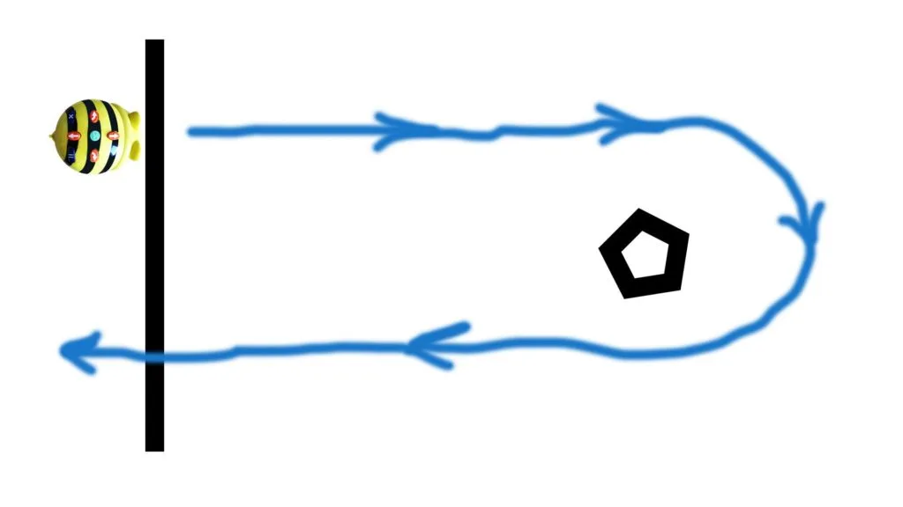

## Material

Tejp, penna, papper, Bee-Bots eller liknande RoBot samt dina bästa läroplansglasögon.

## Ta dig runt hindret {.steg}

Eleverna jobbar i par eller helst fler.
**I vårt exempel har vi en startlinje tejpad på golvet och ett hinder cirka 1,5 meter därifrån. Bee-bot ska starta bakom startlinjen för att sedan runda hindret och därefter avsluta bakom startlinjen igen.**

Eleverna får inte veta hur långt det är till hindret på förhand. De får heller inte veta hur långt en Bee-Bot rör sig på ett steg. De får heller inte veta något mer än att de måste lösa problemet och göra det med penna och papper innan de får prova praktiskt. De får dock testa hur långt en Bee-Bot går på ett steg och själv mäta upp eller uppskatta hur långt det är till hindret.
Tanken är att de ska komma fram till en möjlig lösning på problemet innan de programmerar sina Bee-bots. Det är alltså viktigt att det sker en tankeprocess och ett problemlösande innan, så att de inte bara provar sig fram.
Låt eleverna diskutera och komma på vad de behöver för att kunna lösa uppgiften. Hjälp dem att bryta ned problemet i mindre delar om det behövs.

#### Bryt ned problemet

**Hur långt är det till hindret? Hur ska vi ta reda på det? Vilka pedagogiska hjälpmedel behöver vi?**
Eleverna ska inte använda måttband eller linjal i denna uppgift. Eleverna ska använda andra verktyg, som till exempel uppskattning, handmått, fotmått, måttsnöre, eller varför inte skapa ett eget bee-bot-mått med penna och papper?
Låt eleverna diskutera och komma fram till lösningar.

**Hur långt rör sig en Bee-Bot på ett steg?**
Hur kan vi lösa detta? Och på samma sätt som ovan, behöver vi använda måttband eller linjal, eller finns det andra alternativ?

**Vilken väg ska Bee-Bot ta för att ta sig runt hindret?**
Kan vi bryta ned färdvägen i mindre delar också? Räcker det med att vi tar oss fram till hindret, eller måste vi ta oss förbi också? Ser vi något mönster eller något som upprepar sig?

:::video /media/video/pass007.mp4

I filmen ovan kan ni se ett exempel på hur vi löste uppgiften. På vilka sätt kan eleverna lösa den?

#### Uppgift [A]

**Säker algoritm**
Nu är det dags att sätta ihop instruktionerna och programmera Bee-Bot. Nu har vi alla förutsättningarna rent teoretiskt, men kan vi få det att fungera praktiskt? Vad kan fela? Låt eleverna testa och se om deras algoritm fungerar. Om inte, vad har gått snett? Vad finns det för felkällor? Halt underlag? Fel i koden? Fel i algoritmen?
Det viktiga är att Bee-Bot tar sig runt. För säkerhets skull kan vi ta ut svängarna lite och lägga till några steg i koden, så vi har lite svängrum.

Jämför elevernas kod i slutet på lektionen och diskutera kring vad som var svårt och hur de olika grupperna löste sina problem.

:::fakta
begrepp: Stegvisa Instruktioner, Felsökning, Problemlösning, Symbolers användning
fokus: Problemlösning | Att bryta ned ett problem i mindre delar som går att lösa
ålder: Åk 1, Åk 2
:::

#### Uppgift [B]

**Optimerad algoritm**
Nu när vi lyckats att ta oss runt kan vi börja tänka på om det går att optimera vår algoritm. Går det att ta bort några steg? Kan vi göra på något annat sätt? Vilken grupp har den kortaste koden / minst antal instruktioner? Hur tänkte de? Låt eleverna berätta.

Jämför elevernas kod i slutet på lektionen och diskutera kring vad som var svårt och hur de olika grupperna löste sina problem.

:::fakta
begrepp: Stegvisa Instruktioner, Felsökning, Problemlösning, Symbolers användning
fokus: Problemlösning | Att bryta ned ett problem till mindre delar som går att lösa
ålder: Åk 1, Åk 2
:::
