## Material

Lite ledigt golv där du kan tejpa upp en eller flera spelplaner och dina bästa läroplansglasögon samt de olika symbolerna som du kan ladda ned och skriva ut.

**Spelplan**
Tejpa upp ett rutnät, 4 x 4 - där varje ruta är ca 50 cm, så pass att en elev får plats.

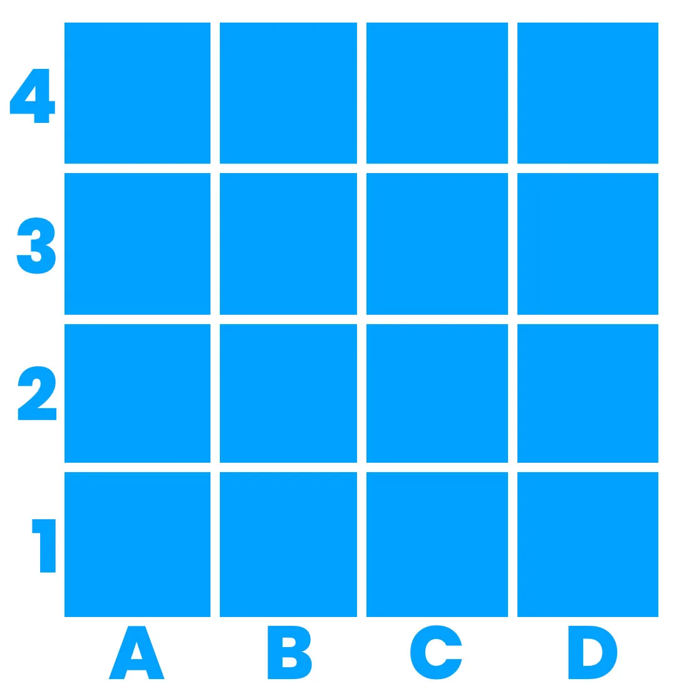

### Symboler / Kodspråk

Ladda hem och skriv ut hela **symbolkartan** som A4 till eleverna. [Ladda ned (PDF) här.](/media/doc/fruktspelet-symboler-pdf.pdf)
Här under kan du även ladda ned de individuella symbolerna i A4-storlek.

<table style="border: 0px;">
<tbody>
<tr>
<td>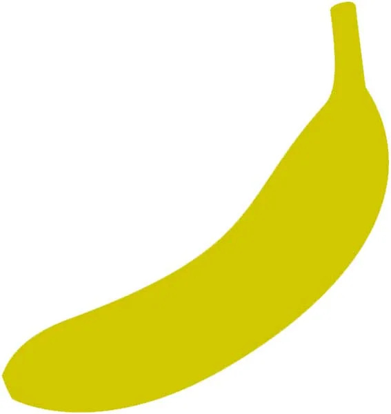</td>
<td><strong>Banan</strong>
Ett steg framåt</td>
<td><a href="/media/doc/banan-pdf.pdf">Ladda ned och skriv ut (PDF)</a></td>
</tr>
<tr>
<td>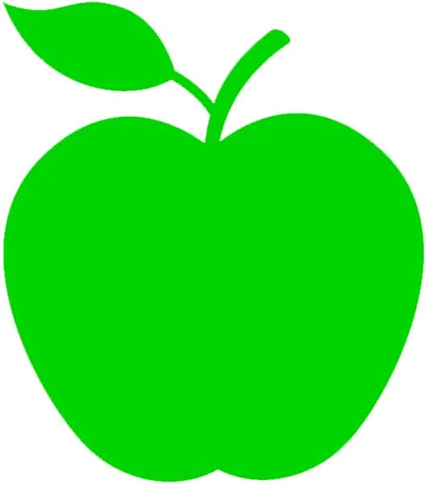</td>
<td><strong>Äpple</strong>
Högerrotation 90°</td>
<td><a href="/media/doc/apple-pdf.pdf">Ladda ned och skriv ut (PDF)</a></td>
</tr>
<tr>
<td>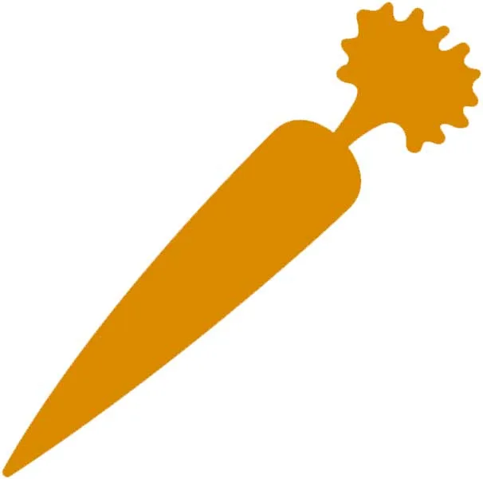</td>
<td><strong>Morot</strong>
Vänsterrotation 90°</td>
<td><a href="/media/doc/morot-pdf.pdf">Ladda ned och skriv ut (PDF)</a></td>
</tr>
<tr>
<td>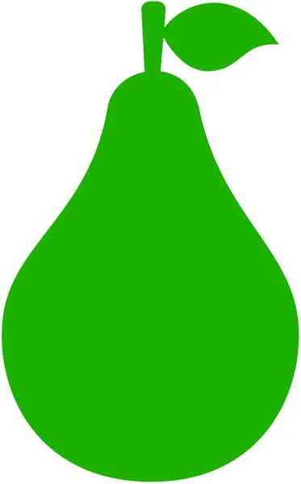</td>
<td><strong>Päron</strong>
Ett steg bakåt</td>
<td><a href="/media/doc/paron-pdf.pdf">Ladda ned och skriv ut (PDF)</a></td>
</tr>
<tr>
<td>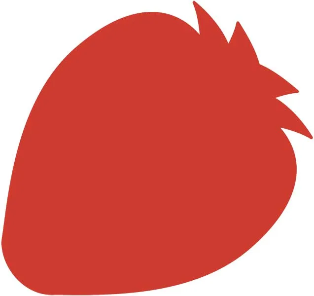</td>
<td><strong>Jordgubbe</strong>
Starta program (GO)</td>
<td><a href="/media/doc/jordgubbe-pdf.pdf">Ladda ned och skriv ut (PDF)</a></td>
</tr>
<tr>
<td>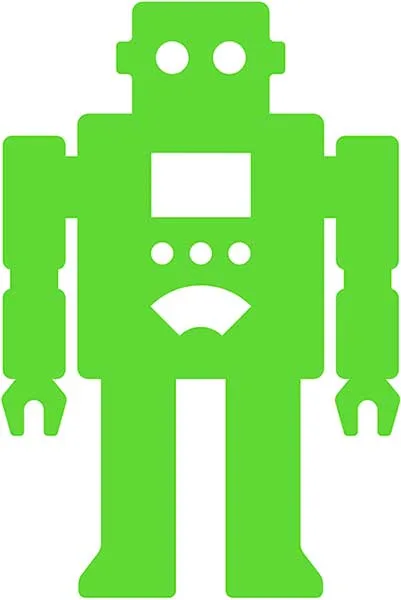</td>
<td><strong>Robotkompis</strong>
Dina kompisar som du ska rädda</td>
<td><a href="/media/doc/robot-pdf.pdf">Ladda ned och skriv ut (PDF)</a></td>
</tr>
<tr>
<td>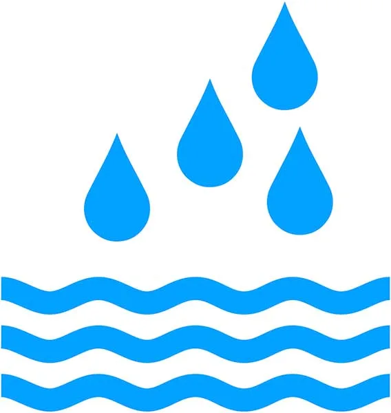</td>
<td><strong>Vattenpöl</strong>
Farligt för elektroniken - Passa dig</td>
<td><a href="/media/doc/vatten-pdf.pdf">Ladda ned och skriv ut (PDF)</a></td>
</tr>
<tr>
<td>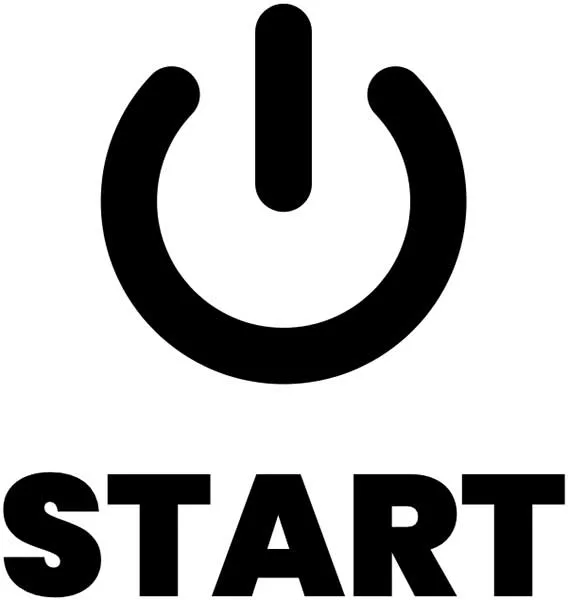</td>
<td><strong>Startplats på spelplanen</strong></td>
<td><a href="/media/doc/start-pdf.pdf">Ladda ned och skriv ut (PDF)</a></td>
</tr>
</tbody>
</table>

## Vi letar efter våra robotkompisar {.steg}

#### Uppgift [A]

Eleverna jobbar i par eller flera.
**Vi börjar med en tom spelplan, förutom en startplats på spelplanen som du sätter till ruta A, 1. Eleverna får tillgång till symbolkartan (antingen som ett A4 eller uppsatt på tavlan).**

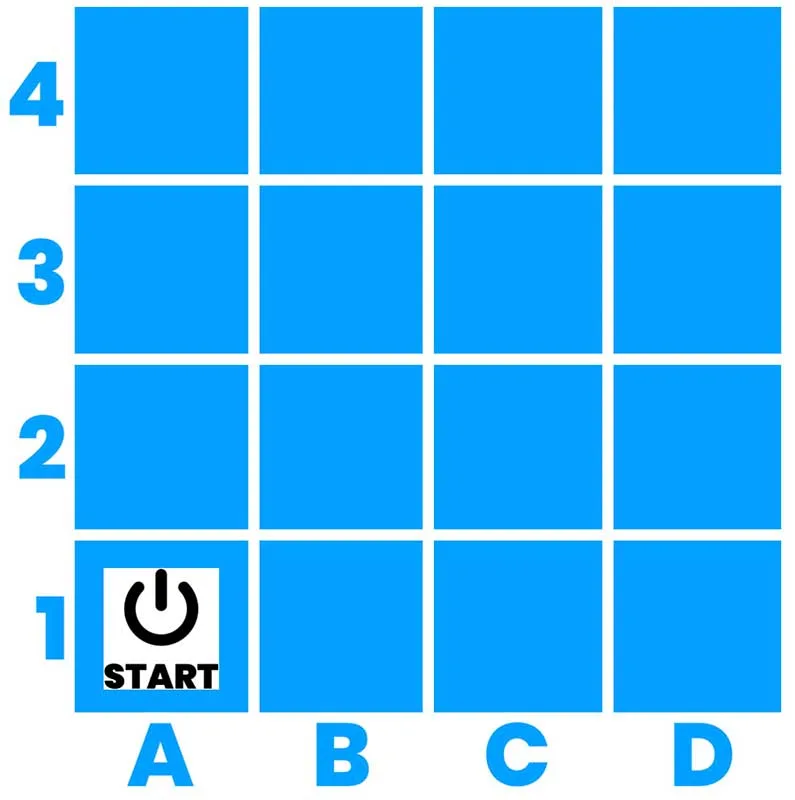

**Eleverna får koden:**
Banan - Banan - Äpple - Banan - Äpple - Banan

          

och får turas om att programmera varandra och agera RoBot.
Var hamnar deras RoBot någonstans? Blev det samma resultat för alla grupper? Hur kan vi beskriva var vi hamnade på spelplanen?
Felsök och prova igen om det inte stämde.

:::fakta
begrepp: Symbolers användning, Stegvisa Instruktioner, Felsökning
fokus: Symbolers användning | Olika symboler kan beskriva stegvisa instruktioner
ålder: Åk 1
:::

## Rädda dina robotkompisar {.steg}

#### Uppgift [A]

Eleverna jobbar i par eller i grupp.
**Börja med en tom spelplan. Låt eleverna placera ut en startplats och en robotkompis på valfri plats på spelplanen. Därefter får de skapa en egen algoritm för att hitta fram till sin robotkompis från startplatsen.**

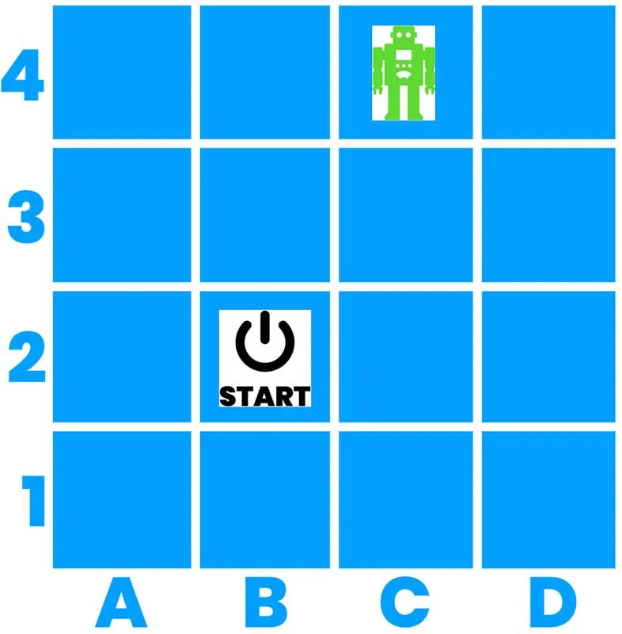

Be eleverna att rita upp sin spelplan med startplats och robotkompis, samt skriva ned koden och testa om den fungerar. Eleverna turas om att programmera och att agera RoBot.
Låt därefter grupperna byta kod med varandra och se om det fungerar.

:::fakta
begrepp: Symbolers användning, Stegvisa Instruktioner, Felsökning, Problemlösning
fokus: Symbolers användning | Olika symboler kan beskriva stegvisa instruktioner
ålder: Åk 1, Åk 2
:::

#### Uppgift [B]

Eleverna jobbar i par eller grupp
**Låt eleverna skapa en spelplan på papper där de inte ritar, utan beskriver eller skriver ned i vilka fältkoordinater som startplatsen, två robotkompisar och två vattenpölar finns.**
Byt sedan papper mellan grupperna och låt dem lägga ut startplats, robotkompisar och vattenpölar på spelplanen enligt instruktionerna. Därefter ska de lösa problemet med att ta sig till bägge robotkompisarna utan att nudda vattenpölarna, genom att skriva ned koden.
Prova sedan koden på den fysiska spelplanen och felsök om det behövs.

:::fakta
begrepp: Symbolers användning, Stegvisa Instruktioner, Felsökning, Problemlösning
fokus: Symbolers användning | Olika symboler kan beskriva stegvisa instruktioner
ålder: Åk 1, Åk 2
:::

#### Uppgift [C]

Eleverna jobbar i par eller grupp.
**Låt eleverna skapa en egen spelplan där de får använda fritt antal vattenpölar och robotkompisar.
De ska också skapa ett kodspråk där frukt- och grönsakssymbolerna nu får nya betydelser, till exempel att bananen nu betyder ett steg tillbaka.**

Låt eleverna skriva ned sitt kodspråk, spelplan och algoritm (lösning) och byt med varandra. Testa koden och felsök om det behövs.
Vill ni, kan ni också lägga till spelelement som att den grupp som löser en uppgift med minst antal instruktioner vinner.

:::fakta
begrepp: Symbolers användning, Stegvisa Instruktioner, Felsökning, Problemlösning
fokus: Symbolers användning | Olika symboler kan beskriva stegvisa instruktioner
ålder: Åk 1, Åk 2
:::
