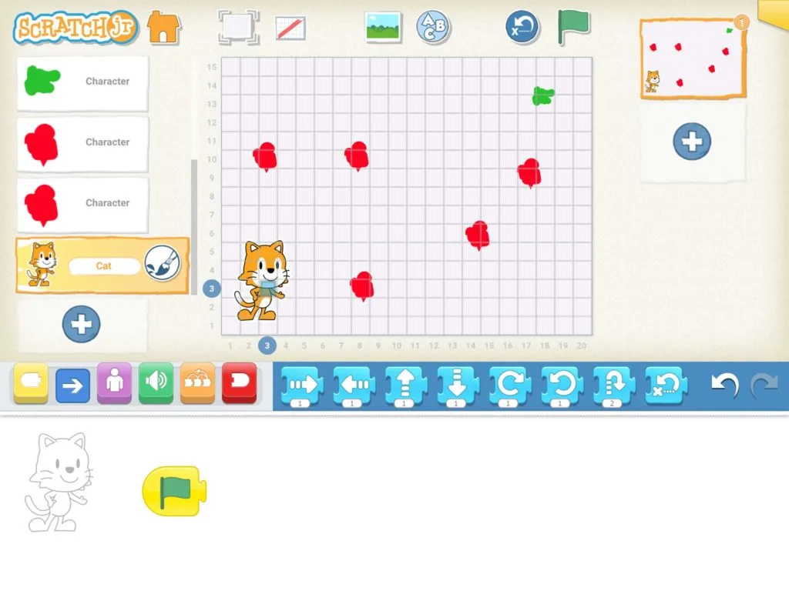

## Material

Digitala enheter med appen ScratchJr och dina bästa läroplansglasögon. Appen ScratchJr finns till iOS, Android och Chromebooks.

Länk till ScratchJr-dokumentet "Giftiga Blomman": [ScratchJr-projektet (gb.sjr)](/media/doc/gb.sjr)

## Giftiga blomman {.steg}

**Nu är det dags att introducera eleverna i visuella programmeringsmiljöer och i denna aktivitet kommer vi att jobba med blockprogrammering i programmet ScratchJr.**
Börja med att visa eleverna rörelseblocken och hur de fungerar - samt de vanligaste övriga blocken, som hur de får fram rutnätet (koordinatsystemet) och helskärmsläge.

#### Uppgift [A] - Ta dig fram till den gröna blomman

Eleverna jobbar parvis i denna uppgift. Eleverna går till och öppnar länken [ScratchJr-projektet (gb.sjr)](/media/doc/gb.sjr) (ScracthJr-projektet) på sin digitala enhet.

**Sprajten Cat vill plocka en blomma till sin pappa. Tyvärr så är den enda blomman som han kan plocka den gröna, då de röda är giftiga. Kan eleverna programmera Cat så att han nuddar den gröna blomman utan att nudda de röda?**
Cat måste alltid starta på fältkoordinaten 3, 3 - så se till att ha rutnätet (koordinatsystemet) framme. Den enda sprajten eleverna får programmera är Cat.

Vi vill att eleverna;
1. tänker ut en färdväg,
2. diskuterar färdvägen och
3. försöker visualisera koden innan de programmerar den.
4. Programmera Cat. Se till att eleverna nu testar sin kod och justerar om det blir fel.
Om det blir fel, låt eleverna felsöka genom att diskutera och hitta felet innan de försöker igen. Detta för att undvika att endast prova sig fram.

Låt slutligen eleverna dela med sig av sina lösningar. Vem kan lösa uppgiften med så få block som möjligt. (Hint: Det går att lösa med två block, förutom startblocket.)

:::fakta
begrepp: Symbolers användning, Felsökning, Stegvisa Instruktioner, Problemlösning
fokus: Visuell programmering | Hur fungerar blockprogrammering?
ålder: Åk 1
:::
