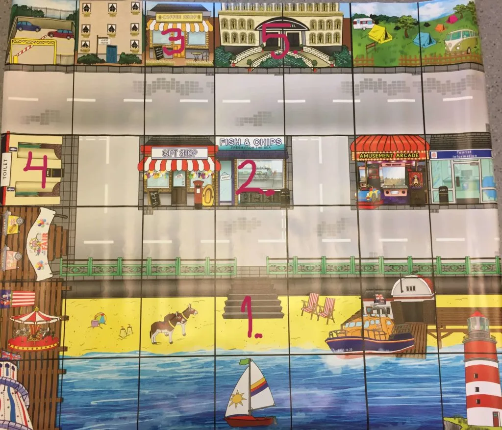

## Material

Bee-Bots, valfri Bee-bot-vänlig matta och dina bästa läroplansglasögon. Det fungerar givetvis med andra liknande RoBotar istället för just Bee-bot.

## Giftiga blomman {.steg}

**Efter en lång dag på stranden, börjar hela familjen att känna sig lite sugen, både på mat och dryck. Vi hoppar in i vår bil, som ser precis ut som en Bee-Bot och fixar lite mat och dryck. Vi känner oss dock lite skyldiga för att vi tar bilen och vi vill ju gärna vara miljösmarta. Därför försöker vi planera vår rutt och åka så miljösmart som möjligt.**

#### Uppgift [A]

Eleverna jobbar i par i denna uppgift.
**Starta från 1. enligt färdbeskrivningen under bilden och planera den rutt som drar minst bensin. Låt eleverna först skriva ned sina lösningar och komma på den bästa färdvägen innan de testar den på mattan. Här måste eleverna försöka komma på flera lösningar, räkna ihop bensinpriserna och välja den billigaste resan.**
Jämför sedan varandras lösningar. Vem kunde åka för billigast pris? Hur tänkte ni? Hade antalet instruktioner något med priset att göra?

**Bensinpriser**
Ett steg fram kostar 1 kr per steg.
Ett steg bak kostar 1 kr per steg.
En högerrotation kostar 2 kr per steg.
En vänsterrotation kostar 2 kr per steg.

**Färdväg**

1. Vi startar på stranden.
2. Vi åker och äter fish & chips.
3. Vi åker till caféet och tar oss en liten fika.
4. Oj, nu blev det mycket mat och dryck. Vi tar en tur till toaletterna.
5. Det här blev en riktig heldag. Vi åker hem till hotellet.

:::fakta
begrepp: Symbolers användning, Felsökning, Stegvisa Instruktioner, Problemlösning
fokus: Problemlösning
ålder: Åk 0, Åk 1
:::
