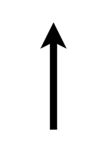
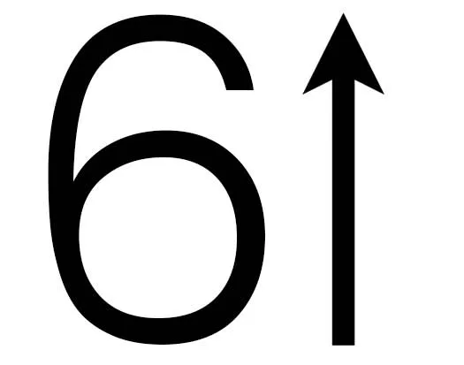
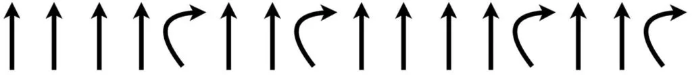
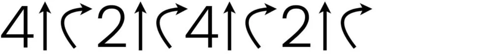
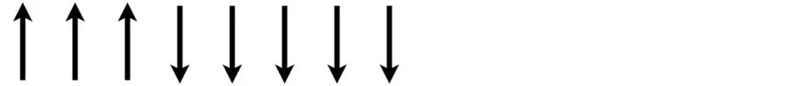
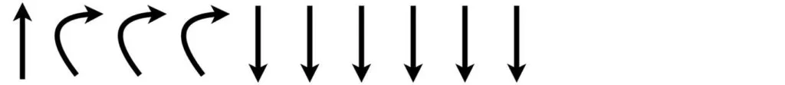

## Material

Penna, papper och dina bästa läroplansglasögon.

## Varför repeterar vi kod? {.steg}

**Visa filmen nedan för eleverna, en film som visar en Bee-bot som rör sig 6 steg framåt. Observera att filmen repeteras för tydlighet och inte har med koden att göra.**
**Låt dem fundera över vilka stegvisa instruktioner som är inmatade och be dem skriva ned koden.**

:::video /media/video/Kodknack-Akt01-1.mp4

Alla borde nu ha kommit fram till följande instruktioner:

**Titta på koden och fråga eleverna om de ser något mönster i den.** Är det något som upprepas? Kan detta förenklas på något sätt? Kan vi visa att vi repeterar en instruktion flera gånger?
Tillsammans kommer vi fram till att samma instruktioner kan skrivas på följande sätt:

Vi upprepar symbolen för pil upp sex gånger. 6 gånger kör vi pil upp.
**Nu tittar vi på en ny film.** Efteråt tittar vi på koden till den sekvensen och hur den kan förkortas med hjälp av repetition.

:::video /media/video/Kodknack-3.mp4

Koden till sekvensen i filmen är:

Om vi använder repetition skulle vi kunna förkorta koden på följande sätt:

Diskutera nu kring vad repetition kan vara bra för. Kan det göra det enklare för oss att läsa? Blir det mindre kod att skriva? Kan vi undvika fel?

## Jobba med repetition (loop) {.steg}

#### Uppgift [A]

Eleverna jobbar parvis i denna uppgift.
**Ge elverna följande kod att skriva ut där de ska använda repetition där det behövs.**

Diskutera och jämför varandras lösningar.

:::fakta
begrepp: Stegvisa Instruktioner, Symbolers användning, Repetition (Loop), Mönster
fokus: Repetition | Hur kan repetition användas?
ålder: Åk 1, Åk 2
:::

#### Uppgift [B]

Eleverna jobbar parvis i denna uppgift.
**Ge elverna följande kod att skriva ut där de ska använda repetition där det behövs.**

Diskutera och jämför varandras lösningar.

:::fakta
begrepp: Stegvisa Instruktioner, Symbolers användning, Repetition (Loop), Mönster
fokus: Repetition | Hur kan repetition användas?
ålder: Åk 1, Åk 2
:::
