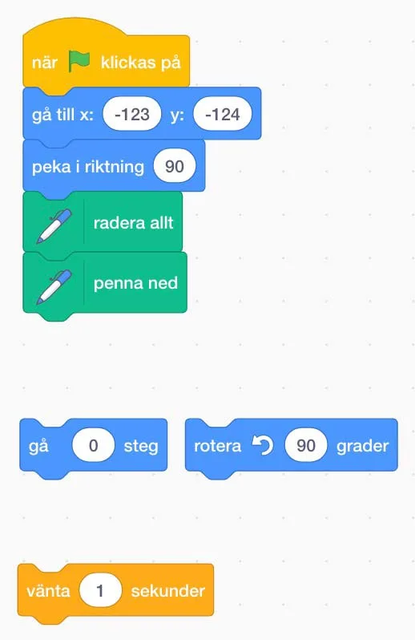
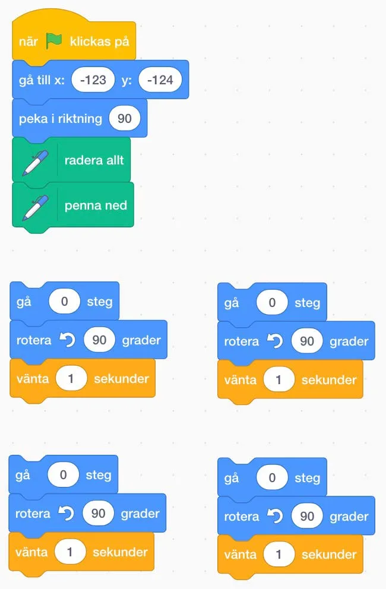
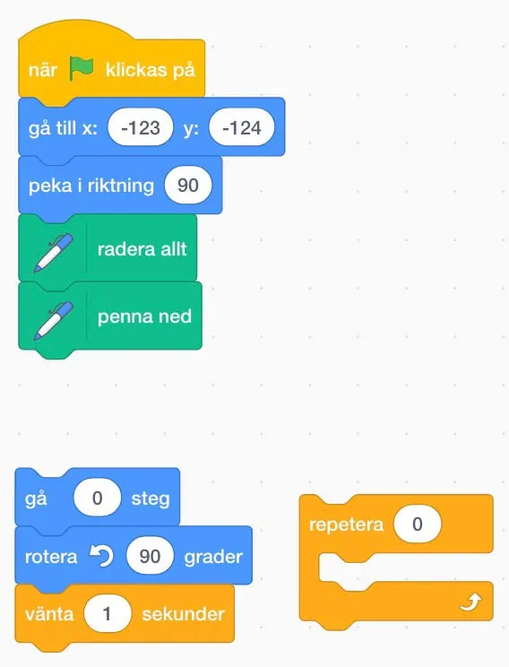

:::video /media/video/2-4.mp4

## Material

Scratch, antingen via dator eller padda samt dina bästa läroplansglasögon. Länkar till projekten finns under varje uppgift.

## Spring runt sjön! {.steg}

#### Uppgift [A]

Eleverna arbetar i par i denna uppgift.
**I den första uppgiften ska vi försöka få Cat att ta sig runt. Börja med att förklara vad de fem första blocken betyder; Att när vi klickar på "grön flagga" så ställer sig Cat på startpositionen (-123, -124) och pekar åt höger - raderar allt som ritats tidigare och sätter ned pennan redo att rita igen.**

**Med hjälp av de nedersta tre blocktyperna (i bilden ovan) får eleverna programmera Cat att ta sig runt utan att nudda sjön.** De kan givetvis använda hur många block de vill av de tre typerna, men de får bara ändra värdet på "gå 0 steg"-blocket. Eftersom vi använder rita, behöver inte eleverna använda "vänta 1 sekunder"-blocket om de inte vill.

Dela varandras kod och diskutera hur de olika grupperna har löst problemet.

**Adress till scratchprojektet** | [https://scratch.mit.edu/projects/258685499](https://scratch.mit.edu/projects/258685499)

:::fakta
begrepp: Stegvisa Instruktioner, Symbolers användning, Problemlösning, Mönster, Felsökning
fokus: Repetition | Hur kan repetition användas?
ålder: Åk 2, Åk 3
:::

#### Uppgift [B]

**Adress till scratchprojektet** | [https://scratch.mit.edu/projects/258655112](https://scratch.mit.edu/projects/258655112)

Eleverna jobbar i par i denna uppgift. Låt eleverna öppna projektet på deras enheter.
**I den andra uppgiften har vi nästan ett färdigt program. Det enda som eleverna ska och får göra är att ändra i de fyra blocken "gå 0 steg".  Därefter ska de sätta ihop kodblocken så att det fungerar. De block som sitter ihop 3-och-3 ska sitta så och ska inte ändras.**
Låt dem fundera över vad kodblocken gör och låt dem sedan testa vad som händer när de ändrar i blocket "gå 0 steg". Be dem att koppla ihop en av de blockgrupperna (som sitter ihop 3-och-3) med startblocken (de 5 som sitter ihop). Dra gärna paralleller mellan hur Bee-bot rör sig och den kod de jobbar med.
**Kom ihåg att Cat ska röra sig i en kvadratisk figur med lika långa sidor.**

Dela varandras kod och diskutera hur de olika grupperna har löst problemet. **Kan eleverna se några mönster i koden?**

*I filmen här under visar vi hur vi löser problemet, där vi först testar hur långt Cat springer på 100 steg, för att sedan hitta rätt. Eftersom alla sidor är lika långa är det bara att skriva in samma siffra i alla fyra blocken.*

:::video /media/video/2-4-ex.mp4

:::fakta
begrepp: Stegvisa Instruktioner, Symbolers användning, Repetition (Loop), Mönster, Felsökning
fokus: Repetition | Hur kan repetition användas?
ålder: Åk 2, Åk 3
:::

#### Uppgift [C]

**Adress till scratchprojektet** | [https://scratch.mit.edu/projects/258677705/](https://scratch.mit.edu/projects/258677705/)

**Nu får eleverna öppna det nya projektet som nästan ser ut som det förra. Skillnaden nu är att vi har med ett nytt block som heter "repetera 0" samt att vi bara har en blockgrupp (som sitter ihop 3-och-3) istället för fyra.**
Låt eleverna fundera ut hur de ska göra med detta nya block för att få programmet att fungera. De får fortfarande bara ändra i "gå 0 steg"-blocket samt repetera-blocket.

Dela varandras kod och diskutera hur de olika grupperna har löst problemet. Jämför de bägge färdiga programmen i uppgift B och C, som gör exakt samma sak och diskutera varför repetition är bra.

*I filmen nedan visar vi hur vi löste uppgiften, där vi först skrev in det värdet vi kom fram till i förra uppgiften, men sedan glömde vi att vi måste repetera "4" gånger. När vi rättat det, fungerade allt.*

:::video /media/video/scratch2-4-22.mp4

:::fakta
begrepp: Stegvisa Instruktioner, Symbolers användning, Repetition (Loop), Mönster, Felsökning
fokus: Repetition | Hur kan repetition användas?
ålder: Åk 2, Åk 3
:::
