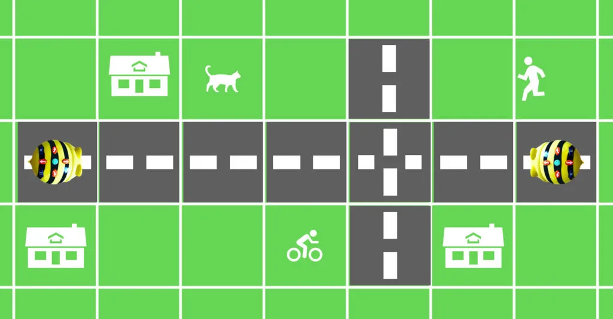
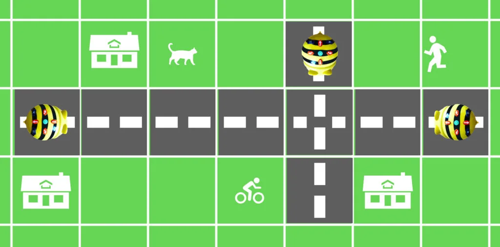

## Material

Penna, papper, Bee-bots eller liknande RoBots, någon form av Bee-bot-matta med väg samt dina bästa läroplansglasögon.

## Möte på smal väg {.steg}

**Uppdragsenheten på Trafikkontoret i RoBotonia behöver din hjälp! I RoBotonia är all trafik robotiserad och alla fordon är självkörande. Det innebärs att de styrs av programmering.**
Nu har Trafikkontoret köpt in en ny typ av fordon som heter Bee-bots. Dock har de lite problem med programmeringen av dessa och därför har de hört av sig till er. Ni måste hjälpa dem att lösa problemet med hur två Bee-bots eller flera ska kunna mötas på en smal väg utan att krocka.

I uppgifterna använder vi vårt kodspråk för Bee-bots som vi jobbade med i årskurs 0, [som du hittar här](/ak-0-aktivitet-03-skriva-kod/).

#### Uppgift [A]

Eleverna arbetar i par eller grupp.
**Placera en Bee-bot på varsin ände av vägen, som i bilden ovan. Uppgiften går ut på att eleverna ska starta bägge Bee-bots samtidigt (trycka på GO) och därmed lyckas ta sig från den ena sidan till den andra utan att krocka.**
Låt eleverna diskutera med varandra hur de ska lösa uppgiften, skriva ned koden på papper, för att sedan testa. Därefter kommer felsökning.
Dela sedan koden med andra grupper och prova varandras. Jämför de olika gruppernas lösningar. Har alla kommit fram till samma lösning?

I filmen nedan kan ni se ett exempel på hur vi på Kodknäck löste uppgiften.

:::video /media/video/samarbetsovning.mp4

:::fakta
begrepp: Stegvisa Instruktioner, Symbolers användning, Felsökning, Problemlösning
fokus: Problemlösning | Skapa kod för två olika RoBotar som ska interagera
ålder: Åk 2, Åk 3
:::

#### Uppgift [B]

Nu ökar vi svårighetsgraden en smula. Kan vi på samma sätt som i A-uppgiften lösa problemet, men nu med tre Bee-bots?

:::fakta
begrepp: Stegvisa Instruktioner, Symbolers användning, Felsökning, Problemlösning
fokus: Problemlösning | Skapa kod för tre olika RoBotar som ska interagera
ålder: Åk 2, Åk 3, Åk 4
:::
