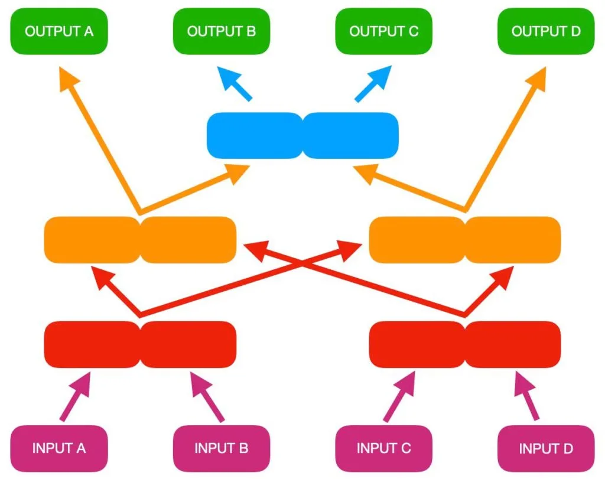

## Material

Bygg en sorteringsmaskin, till exempel genom att lägga ut papptallrikar eller något annat på golvet i klassrummet och tejpa upp linjerna enligt bilden (se även filmen från UR längre ned). Ett annat tips kan vara att ta en vit presenning och måla upp sorteringsmaskinen med pennor, så att flera kan använda den. Givetvis behövs också dina bästa läroplansglasögon.

## Sorteringsmaskinen {.steg}

**Data som matas in eller skapas i ett program kan sorteras på olika sätt. Hur den sorteras bestäms av den algoritm som programmeraren har skapat. Ett exempel skulle kunna vara att visa upp en lista med high score i ett spel, där poängen sorteras från högst till lägst.**
I den här aktiviteten ska eleverna få bli sorterade och därmed se om algoritmen fungerar.

#### Uppgift [A]

Eleverna arbetar i grupper om fyra i denna uppgift.
**I den första uppgiften ska vi försöka sortera oss i bokstavsordning baserat på våra förnamn, från A-Ö, där A är lägst och Ö högst. Om bägge eleverna heter något som börjar på samma bokstav går vi även på den andra bokstaven i förnamnet.**

När ni gör uppgiften, lägg gärna lite tyngd på att algoritmen **använder villkor för att sortera**.
*OM A(nna) kommer före B(enny) i alfabetet*
*GÅ till vänster*
*ANNARS*
*GÅ till höger*

**Sorteringsinstruktion**

1. Lila block | De fyra eleverna ställer sig på varsitt input.
2. Röda block | Eleverna tar ett steg fram och möts på de röda blocken, där de frågar varandra vad de heter (A och B samt C och D frågar varandra och jämför). Den vars förnamn kommer först i alfabetet går till vänster och den andra går till höger. Observera vart pilarna pekar.
3. Orange block | Återigen frågar eleverna varandra vad de heter och den eleven vars förnamn kommer först i alfabetet går till vänster och den andra till höger.
4. Blå och gröna block | Nu har algoritmen sorterat fram den tidigaste och senaste bokstaven i alfabetet, så det är bara de två eleverna i det blåa blocket kvar. De gör en sista sortering enligt samma modell som tidigare.
5. Nu är sorteringen klar. Fungerade det?

#### Film - Sortering - Programmera Mera UR

I filmen nedan ser ni ett exempel på denna uppgift.

<iframe title="Programmera mera - lektionstips : Sortering" src="https://embed.ur.se/embed/197442?cid=oi0cg-8bkv5z#start=57&amp;stop=129" width="670" height="380" frameborder="0" allowfullscreen="allowfullscreen"></iframe>

:::fakta
begrepp: Stegvisa Instruktioner, Sortering, Villkor, Algoritm
fokus: Sortering | Hur kan algoritmer användas för sortering?
ålder: Åk 2, Åk 3
:::

#### Uppgift [B]

**Nu vill vi att eleverna kommer på egna exempel på vad de kan sortera och testar om det fungerar i sorteringsmaskinen.**
Exempel på sortering skulle kunna vara längd på eleverna i centimeter, födelsedatum eller annat.

:::fakta
begrepp: Stegvisa Instruktioner, Sortering, Villkor, Algoritm
fokus: Sortering | Hur kan algoritmer användas för sortering?
ålder: Åk 2, Åk 3
:::

#### Uppgift [C]

**Kan vi ändra ordningen på sorteringsmaskinen, så att den sorterar från högst till lägst, istället för tvärtom? Hur gör vi då? Och om det skulle vara så att det finns två lika värden (exempelvis 20, 21, 21, 23), hur gör vi för att sortera dessa?**
Låt eleverna jobba i grupp och diskutera samt testa sin algoritm.

:::fakta
begrepp: Stegvisa Instruktioner, Problemlösning, Sortering, Villkor, Algoritm
fokus: Sortering | Hur kan algoritmer användas för sortering?
ålder: Åk 2, Åk 3
:::

## Sorteringsmaskinen i Scratch {.steg}

**Vi har programmerat sorteringsmaskinen i Scratch, så vill ni testa hur den skulle fungera kan ni klicka på länken [https://scratch.mit.edu/projects/259031834/](https://scratch.mit.edu/projects/259031834/)**
Klicka på mellanslagstangenten för att rensa alla tal och dra i reglagen för att sätta input-talen och grön flagga för att starta maskinen.
I filmen nedan ser ni en kort demo.

:::video /media/video/sortering.mp4
