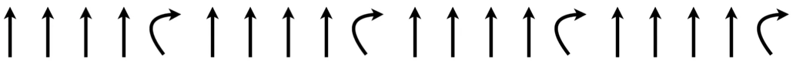
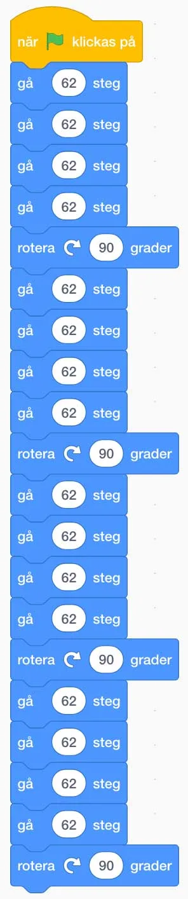
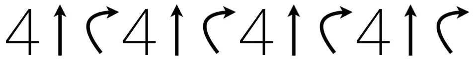
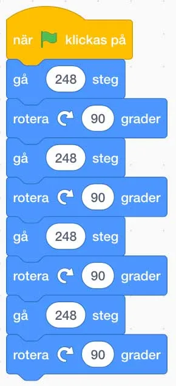
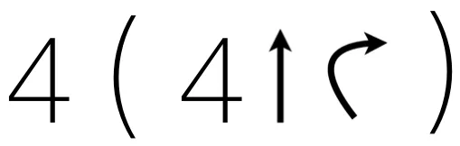
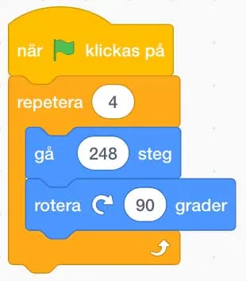
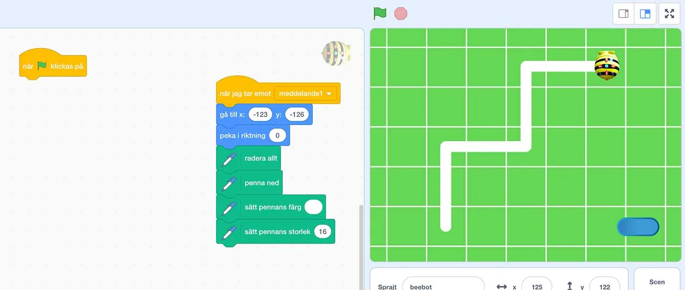

## Material

Penna, papper, digital enhet, scratchprojekten (som finns under uppgifterna) och dina bästa läroplansglasögon.

## Repetition - vad är det bra för? {.steg}

**Charlie, Ruby och Kim skulle alla lösa ett problem de hade fått. Deras Bee-bot skulle röra sig i en kvadratisk figur där varje sida skulle vara fyra bee-bot-steg långa. Dock var de tvungna att skriva sitt program i Scratch.  De hade fått ett projekt som innehöll en matta med ett rutnät som de skulle jobba i.**
Först satte sig alla tre ned och funderade på hur de skulle lösa problemet. Det är ju mycket lättare att klura ut en lösning på ett problem innan programmeringen görs.
Därefter skulle de testa sina lösningar i Scratch. Först testade de vilket värde i ett "gå x steg"-block i Scratch som representerar ett bee-bot-steg på mattan i Scratch och kom fram till att det var 62. Nu var det dags att programmera.

**Charlie** skrev ned sin Bee-bot kod såhär på sitt papper:

I Scratch blev koden:

**Ruby** tyckte att Charlies kod såg lite lång och klurig ut, så för att förkorta den skrev Ruby sin kod såhär på sitt papper:

I Scratch blev det såhär, eftersom Ruby räknade ut att 4 x 62 = 248 och då bara behövde använda ett "gå"-block istället för 4.

**Kim** kliande sig i huvudet och plötsligt blixtrade det till! Det finns ju flera block som upprepar sig. Kim hade sett ett mönster och skrev ned sin kod såhär på sitt papper:

Vi kan ju repetera (loopa) koden inom parentestecknen fyra gånger, så borde det vara samma sak, som de övriga lösningarna. Kims kod i Scratch blev då såhär:

Men fungerade då allas kod? Vi tittar på filmen här under.

:::video /media/video/3-2.mp4

Jomenvisst fungerade allas kod. Tre olika sätt att programmera, men i grunden samma lösning, eller algoritm.
**Är någon lösning är mer rätt eller fel än de andra? Diskutera i helklass och prata om vad eleverna tycker eller tror är bra och låt dem motivera sina svar.**

## Härma Charlie, Ruby och Kim {.steg}

**I de tre kommande uppgifterna är det nu dags för eleverna att härma våra vänner Charlie, Ruby och Kim.**
Eleverna ska få Bee-bot att rita början på en trappa, som i bilden ovan. Trappans sidor är två bee-bot-steg långa. Vi vill att eleverna i par funderar på hur koden ska se ut och hur de ska lösa problemet. Därefter skriver de ned koden på papper, för att sedan ta det till scratchprojektet.

**Lösningen programmeras under "när grön flagga klicka på"-blocket. Den blå knappen i projektet används för att återställa Bee-bots position och att radera det som ritats tidigare.**

[Länk till scratchprojektet](https://scratch.mit.edu/projects/260956651)

#### Uppgift [A]

Eleverna jobbar parvis i denna uppgift.
**I den här uppgiften vill vi att eleverna ska lösa problemet så som Charlie skulle ha löst det.**
Titta på Charlie kod i den förra uppgiften för referens. Jämför varandras kod efter de löst problemet och låt eleverna motivera varför de löst sitt problem på det sätt de gjort.

:::fakta
begrepp: Stegvisa Instruktioner, Symbolers användning, Problemlösning
fokus: Repetition | Hur kan repetition användas?
ålder: Åk 3, Åk 4
:::

#### Uppgift [B]

Eleverna jobbar parvis i denna uppgift.
**I den här uppgiften vill vi att eleverna ska lösa problemet så som Ruby skulle ha löst det.**
Titta på Rubys kod i den förra uppgiften för referens. Jämför varandras kod efter de löst problemet och låt eleverna motivera varför de löst sitt problem på det sätt de gjort.

:::fakta
begrepp: Stegvisa Instruktioner, Symbolers användning, Repetition (Loop), Problemlösning
fokus: Repetition | Hur kan repetition användas?
ålder: Åk 3, Åk 4
:::

#### Uppgift [C]

Eleverna jobbar parvis i denna uppgift.
**I den här uppgiften vill vi att eleverna ska lösa problemet så som Kim skulle ha löst det.**
Titta på Kims kod i den förra uppgiften för referens. Jämför varandras kod efter de löst problemet och låt eleverna motivera varför de löst sitt problem på det sätt de gjort.

:::fakta
begrepp: Stegvisa Instruktioner, Symbolers användning, Repetition (Loop), Problemlösning
fokus: Repetition | Hur kan repetition användas?
ålder: Åk 3, Åk 4
:::
