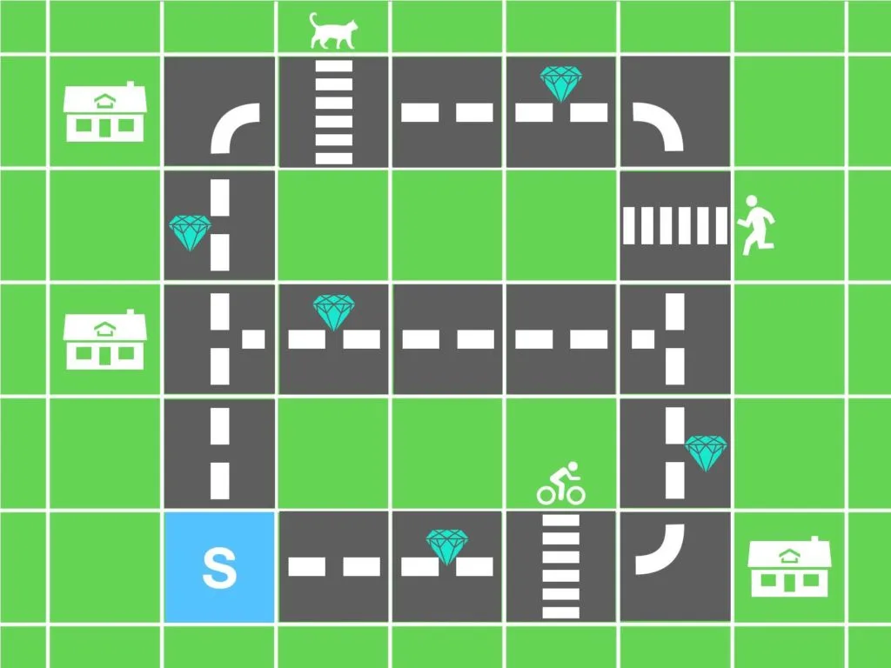
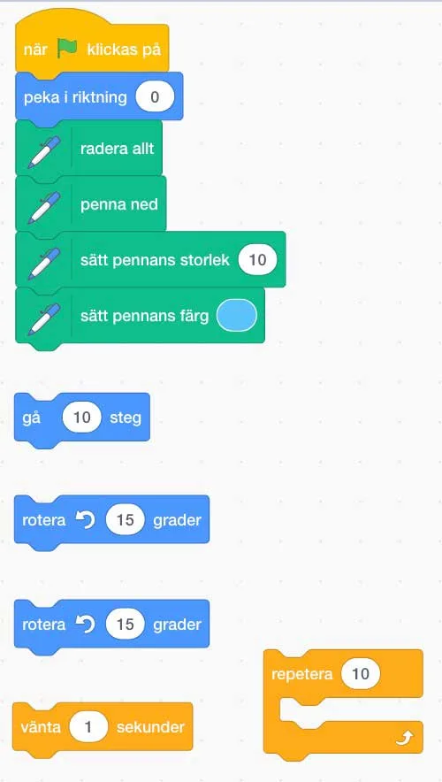

## Material

Digital enhet och en remix av scratchprojektet (länk här under) samt dina bästa läroplansglasögon.

[Scratchprojekt Miljöjakten - Scratch](https://scratch.mit.edu/projects/259428706)

## Miljöjakten - Rädda diamanterna {.steg}

**Bee-bot kör sällan bil in till staden, då stadstrafik drar mycket bensin och lokaltrafik är mycket mer miljövänligt. Idag var den dock tvungen, för att hämta upp sin programmerares nyslipade diamanter från juveleraren. Tyvärr märkte Bee-bot när den kom hem att den råkat glömma att stänga bagageluckan. Fem diamanter saknas nu och därför måste den åka tillbaka och leta efter dem.**
För att spara på både bensin och pengar - och därmed också miljön, måste den planera sin färd smart. Den måste ha den bästa algoritmen. Och den ska ni skapa.

#### Kodblock

I scratchprojektet finns några block som sitter ihop med startblocket som ni **inte ska ändra**. De gör så att Bee-bot pekar i rätt riktning, och ställer in pennan så att vi kan se banan som den kör. Det finns också ett startblock som gör att när ni klickar på **mellanslagstangenten** så rensas allt och återställs.

De lösa kodblocken som ligger längst ned är de ni ska välja av - och sätta ihop till ett fungerande program.

#### Regler

Eleverna får använda de fem typer av kodblock som ligger löst i programmeringsytan; **"gå 10 steg"**, **"rotera 15 grader"** (åt bägge hållen), **"vänta 1 sekunder"** och **"repetera 10"**.
De får givetvis ändra värdena i blocken och använda hur många som helst av dessa block.

En paus (vänta i 1 sekund) måste alltid användas innan de korsar ett övergångsställe.

#### Besinpriser

**För att få fram den mest miljövänliga färdvägen, så ska vi åka så billigt som möjligt.**

De orange blocken kostar ingenting och kan därmed användas hur mycket som helst.

- "Gå 10 steg"-blocket kostar 1 krona per block, oavsett värde i blocket.
- "Rotera 15 grader"-blocket kostar 2 kronor per block, oavsett värde i blocket, eftersom det drar mer bensin att svänga.

Om eleverna använder repetition så räknas bara antalet blå block inom repetitionen, inte multiplicerat med antal repetitioner. Detta för att vi ska premiera användandet av repetition.
**I filmen nedan visas en lösning på problemet som alltså kostar 9 kronor, då vi bara räknar de blåa blocken.**

:::video /media/video/miljojakten2.mp4

#### Uppgift [A]

Eleverna jobbar i par i denna uppgift.
**Låt eleverna lösa problemet så att Bee-bot hämtar upp alla diamanterna, det vill säga kör igenom de rutor som innehåller diamanter. Låt eleverna lösa problemet hur de vill (dock enligt reglerna ovan), men att de försöker göra det så billigt som möjligt, enligt bensinprislistan. Bee-bot startar och avslutar från den blå startrutan.**
Jämför och visa upp varandras lösningar i helklass och se vilka som kommit fram till den billigaste lösningen. Diskutera också hur de har tänkt för att komma fram till sin lösning.

:::fakta
begrepp: Stegvisa Instruktioner, Problemlösning, Repetition, Felsökning, Algoritm, Symbolers användning
fokus: Problemlösning | Hur kan vi använda kod för att lösa problem?
ålder: Åk 3, Åk 4
:::

#### Uppgift [B]

Eleverna jobbar i par i denna uppgift.
**Låt eleverna lösa problemet så att Bee-bot hämtar upp alla diamanterna, det vill säga kör igenom de rutor som innehåller diamanter. Eleverna måste i denna uppgift använda minst ett repetitionsblock, förutom de övriga.** **Bee-bot startar och avslutar från den blå startrutan.**
Jämför och visa upp varandras lösningar i helklass och se vilka som kommit fram till den billigaste lösningen. Diskutera också hur de har tänkt för att komma fram till sin lösning.

:::fakta
begrepp: Stegvisa Instruktioner, Problemlösning, Repetition, Felsökning, Algoritm, Symbolers användning
fokus: Problemlösning | Hur kan vi använda kod för att lösa problem?
ålder: Åk 3, Åk 4
:::

#### Uppgift [C]

**Analysera tillsammans koden i videon här under. Kan de se hur programmeraren tänkt när den skapade sin algoritm? Var det en smart lösning eller finns det bättre?**

:::video /media/video/miljojakten2.mp4

:::fakta
begrepp: Stegvisa Instruktioner, Problemlösning, Repetition, Felsökning, Algoritm, Symbolers användning
fokus: Problemlösning | Hur kan vi använda kod för att lösa problem?
ålder: Åk 3, Åk 4
:::
