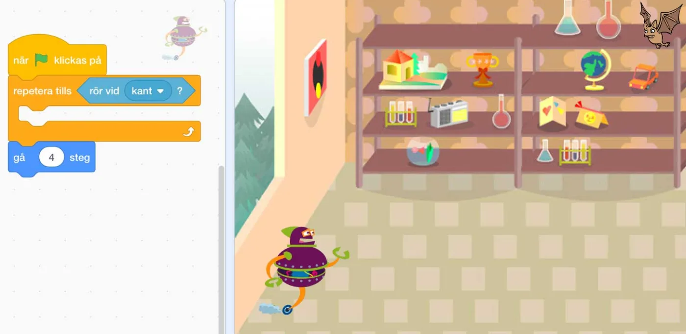
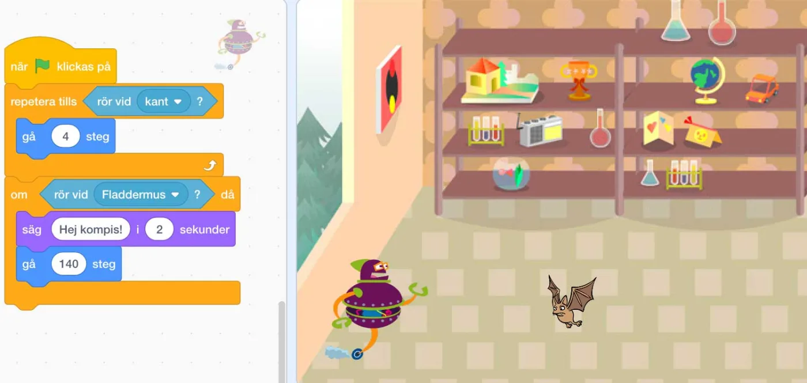
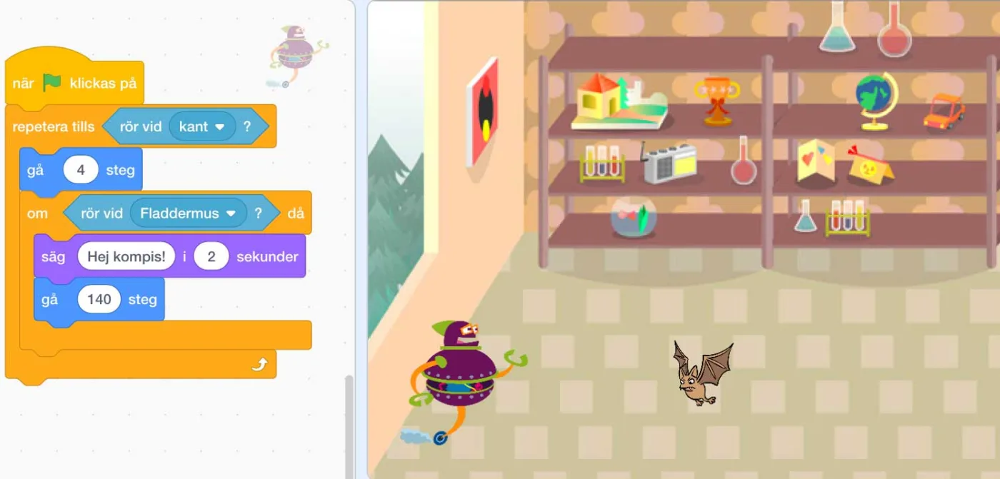

## Material

Digital enhet, scratchprojekten som finns för varje uppgift och dina bästa läroplansglasögon.

## Något i vägen - RoBot med villkor {.steg}

**Den här aktiviteten är en vidareutveckling av [aktiviteten från årskurs 2](/ak-2-aktivitet-02-robot-med-villkor/), fast nu använder vi oss av visuell programmering i Scratch.**
Målet är att vår RoBot ska ta sig från ena sidan av rummet till den andra. Med hjälp av repetition (loop) och villkor (if - else) ska vår algoritm se till att det sker. **Om** vår kompis Fladdermusen står i vägen, **då** ska RoBot även säga hej till honom, **annars** ska RoBot fortsätta att gå tills den nuddar väggen.

:::video /media/video/robotscratch-villkor.mp4

*I filmen ovan ser ni en och samma algoritm och kod, men i ena fallet, när Fladdermusen inte är i vägen, så fortsätter RoBot att gå rakt fram - och i det andra fallet så säger den hej.*

**Tänk på att prata om och diskutera kring vad som händer när koden körs steg-för-steg i de olika uppgifterna.**

#### Uppgift [A]

Eleverna jobbar parvis i denna uppgift.
**RoBot ska ta sig från den ena sidan av rummet till den andra så snabbt och rakt det bara går. Det finns ingenting i vägen, men något har blivit fel när vi programmerade den. Något eller några block ligger fel.**

Låt eleverna först fundera kring vad som är fel i koden ovan. Tänk på att låta dem analysera ordningen i vilken kodblocken körs, steg-för-steg och vad som händer när vi kör igång programmet.
Därefter får de öppna projektet nedan och testa om deras lösning fungerade.

Diskutera sedan i klass hur eleverna hade tänkt och vad som var svårt.

**Scratch** |  [https://scratch.mit.edu/projects/260679084](https://scratch.mit.edu/projects/260679084)

:::fakta
begrepp: Stegvisa Instruktioner, Symbolers användning, Repetition (Loop), Villkor, Problemlösning, Felsökning
fokus: Felsökning och stegvisa instruktioner | Vad ska programmet göra?
ålder: Åk 3
:::

#### Uppgift [B]

Eleverna jobbar parvis i denna uppgift.
**RoBot ska ta sig från den ena sidan av rummet till den andra så snabbt och rakt det bara går. Lite längre fram ser den sin kompis Fladdermusen och vill säga hej när den rör den om den är kvar då den kommit dit. Om Fladdermusen inte är kvar, ska RoBot fortsätta att gå.
Men... återigen har något blivit fel i programmeringen. Något eller några block ligger fel.**

Låt eleverna först fundera kring vad som är fel i koden ovan. Tänk på att låta dem analysera ordningen i vilken kodblocken körs, steg-för-steg och vad som händer när vi kör igång programmet.
Därefter får de öppna projektet nedan och testa om deras lösning fungerade.

Diskutera sedan i klass hur eleverna hade tänkt och vad som var svårt.

**Scratch** | [https://scratch.mit.edu/projects/260678765](https://scratch.mit.edu/projects/260678765)

:::fakta
begrepp: Stegvisa Instruktioner, Symbolers användning, Repetition (Loop), Villkor, Problemlösning, Felsökning
fokus: Felsökning och stegvisa instruktioner | Vad ska programmet göra?
ålder: Åk 3
:::

#### Uppgift [C]

Eleverna jobbar parvis i denna uppgift.
**Nu stämmer äntligen koden, men... nu ska eleverna själva hitta på vad RoBot ska göra när den träffar på - och rör vid - Fladdermusen. Koden ska fortfarande göra så att RoBot fortsätter att gå om Fladdermusen inte är i närheten.**

Fundera på vad din RoBot ska göra när den träffar Fladdermusen. Kanske vill ni att den spelar upp ett ljud, eller dansar en liten dans? Det är upp till er.

Avsluta med att visa upp elevernas program och diskutera hur de löst sin uppgift.

**Scratch |** [https://scratch.mit.edu/projects/260349090](https://scratch.mit.edu/projects/260349090)

:::fakta
begrepp: Stegvisa Instruktioner, Symbolers användning, Repetition (Loop), Villkor, Problemlösning, Felsökning
fokus: Villkor | Hur kan villkor användas?
ålder: Åk 3
:::
