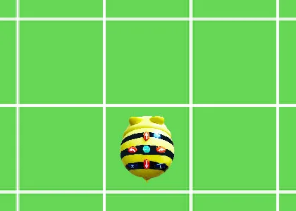
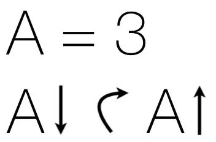
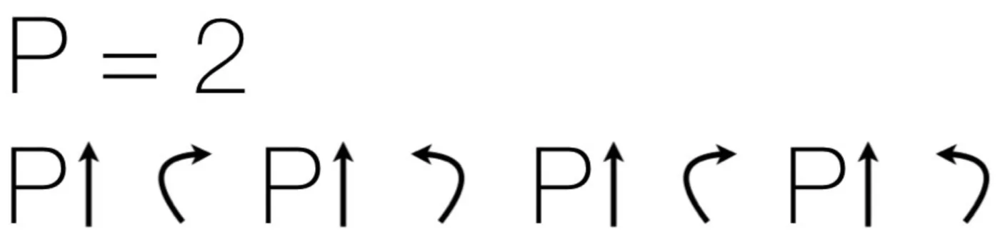
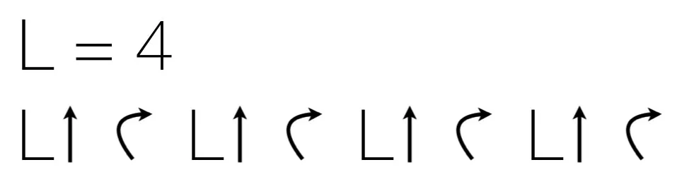

## Material

Rutat papper, minst en gånger en centimeter eller mer så att det inte blir för plottrigt. Digitala enheter behövs också till den sista uppgiften. Givetvis också dina bästa läroplansglasögon.

## Variabel {.steg}

**Börja med att förklara för eleverna vad en variabel inom programmering är. Vi kan likna en variabel med en låda, där vi kan lagra saker, till exempel tal och text. När som helst i vårt program kan vi sen använda det som finns lagrat i vår variabel men även förändra den.**
En variabel kan vi använda för att till exempel låta ett program komma ihåg och lagra vad användaren heter. Ett annat användningsområde kan också vara att lagra och komma ihåg poäng som användaren får i ett spel.

#### Uppgift [A]

**I den här uppgiften utgår vi från våra Bee-bots, som vi använde på lågstadiet - och den kod vi använde oss av för att beskriva dess rörelser och repetition. [Klicka här för att se den aktiviteten](/ak-2-aktivitet-01-repetition-loop/).**

Eleverna arbetar i par.
Skriv upp koden nedan på tavlan. Som i bilden nedan så pekar Bee-bot med nosen uppåt.
Låt sedan eleverna fundera tillsammans hur de tror att figuren kommer att se ut. Låt dem sedan rita upp den på rutat papper. Jämför och diskutera därefter de olika lösningarna eleverna kommit fram till (om de kommit fram till olika lösningar).

**KOD - där variabeln A är lika med 3**

:::fakta
begrepp: Stegvisa Instruktioner, Variabler, Symbolers användning
fokus: Variabler | Introduktion till variabler
ålder: Åk 3, Åk 4
:::

#### Uppgift [B]

**I den här uppgiften utgår vi från våra Bee-bots, som vi använde på lågstadiet - och den kod vi använde oss av för att beskriva dess rörelser och repetition. [Klicka här för att se den aktiviteten](/ak-2-aktivitet-01-repetition-loop/).**

Eleverna arbetar i par.
Skriv upp koden nedan på tavlan. Som i bilden nedan så pekar Bee-bot med nosen uppåt.
Låt sedan eleverna fundera tillsammans hur de tror att figuren kommer att se ut. Låt dem sedan rita upp den på rutat papper. Jämför och diskutera därefter de olika lösningarna eleverna kommit fram till (om de kommit fram till olika lösningar).

**KOD - där variabeln P är lika med 2**

:::fakta
begrepp: Stegvisa Instruktioner, Variabler, Symbolers användning
fokus: Variabler | Introduktion till variabler
ålder: Åk 3, Åk 4
:::

#### Uppgift [C]

**I den här uppgiften utgår vi från våra Bee-bots, som vi använde på lågstadiet - och den kod vi använde oss av för att beskriva dess rörelser och repetition. [Klicka här för att se den aktiviteten](/ak-2-aktivitet-01-repetition-loop/).**

Eleverna arbetar i par.
Skriv upp koden nedan på tavlan. Som i bilden nedan så pekar Bee-bot med nosen uppåt.
Låt sedan eleverna fundera tillsammans hur de tror att figuren kommer att se ut. Låt dem sedan rita upp den på rutat papper. Jämför och diskutera därefter de olika lösningarna eleverna kommit fram till (om de kommit fram till olika lösningar).

**KOD - där variabeln L är lika med 4**

#### Laborera med variabeln L i Scratch

:::video /media/video/lvariabel.mp4

**Vi avslutar aktiviteterna med att titta på samma kod som i uppgift C, fast programmerad i Scratch.**
Låt eleverna öppna dokumentet och prova att förändra variabeln L för att se vad som händer. Fungerade det på samma sätt som när de gjorde aktiviteten med penna och papper.
Mellanslagstangenten rensar scratchytan och grön flagga kör programmet.

**Scratch** - [https://scratch.mit.edu/projects/271201021/](https://scratch.mit.edu/projects/271201021/)

:::fakta
begrepp: Stegvisa Instruktioner, Variabler, Symbolers användning
fokus: Variabler | Introduktion till variabler
ålder: Åk 3, Åk 4
:::
