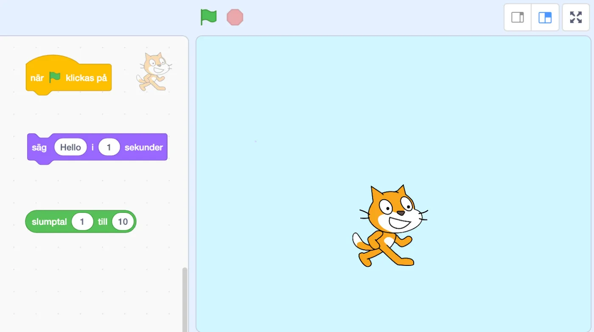
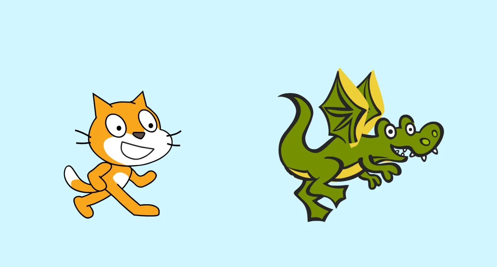
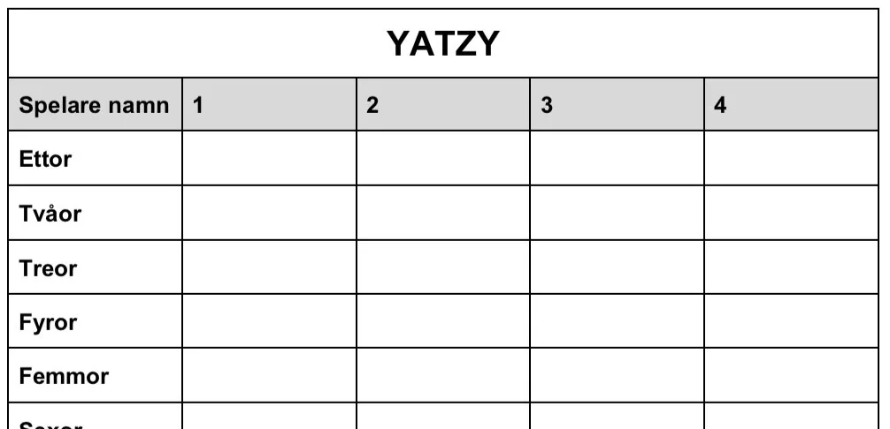

## Material

Digitala enheter för att jobba med Scratch, penna och papper samt dina bästa läroplansglasögon.

## Introduktion - Slump (Random) {.steg}

**Börja med att gå igenom med eleverna vad slump är. Kanske har ni redan jobbat med slump och fysiska tärningar och då finns förförståelsen där.**
Inom programmering kan vi använda slump till en massa olika saker. Alltifrån att välja hur många eller hur snabbt ett monster ska röra sig i ett spel, eller till att slumpa fram frågor i ett frågesportspel, eller slumpa fram olika tal i en uppgift som ska lösas.

#### Slumpfilm - PiCatsso - ett exempel på hur slump kan användas

:::video /media/video/picatsso.mp4

I den här exempelfilmen så kan ni se katten PiCatsso rita en tavla. Den är nästan helt baserad på slump - hur PiCatsso rör sig, om pennan ska vara uppe eller nere, vilken färg, hur tjock pennan ska vara samt hur många streck som ska ritas. Det gör att varje tavla som PiCatsso ritar blir helt unik. Tacka slumpen för det!

Vill ni testa att redigera programmet i filmen så finns det här [https://scratch.mit.edu/projects/271895319/](https://scratch.mit.edu/projects/271895319/)

## Tärningskast {.steg}

#### Uppgift [A]

**Kattens familj är på semester och tältar mitt ute i skogen i djupaste Dalarna. Tyvärr så regnar det ute, men då kom ju Katten på att de kunde spela ett spel och kasta tärning. Om man slår ett jämt tal så får man en poäng och om man slår ett udda tal, så får man två poäng. Den som kommer först till 20 eller mer vinner.**
Men... det finns ju inga tärningar! Åhhhh. Fast vänta! Katten hade ju med sig sin laptop, så nu måste vi hjälpa Katten att programmera en enkel tärning.

Eleverna arbetar i par i denna uppgift.
Låt eleverna öppna scratchprojektet [https://scratch.mit.edu/projects/271879480/](https://scratch.mit.edu/projects/271879480/). Tre block ligger framme (som i bilden ovan). Låt eleverna prova sig fram hur de kan få sprajten att säga ett slumpmässigt tal mellan 1 och 6 genom att förena blocken. Diskutera därefter hur eleverna gjort. Hur vet de att tärningen fungerar?

När de gjort detta, kan de spela spelet med varandra med hjälp av sin tärning. Först till 20. Jämnt tal - en poäng, udda tal - två poäng. Håll räkningen med hjälp av penna och papper.

:::fakta
begrepp: Stegvisa Instruktioner, Slump, Symbolers användning
fokus: Slump | Introduktion till slump
ålder: Åk 3, Åk 4
:::

#### Uppgift [B]

**Det här spelet var ju jättekul, men nu tänkte vi använda oss av två tärningar. Hur gör vi då?**
Vi kan ju låta Kattens kompis Draken slå en tärning samtidigt som Katten, så får vi två tärningsslag.

Eleverna arbetar i par i denna uppgift.
Låt eleverna öppna scratchprojektet [https://scratch.mit.edu/projects/272165893/](https://scratch.mit.edu/projects/272165893/). De tre blocken vi använde i den förra uppgiften ligger fortfarande framme på Katten. Men nu måste de även programmera sprajten Draken, så att den också slår ett tärningskast när du trycker på grön flagga.
Låt eleverna prova sig fram hur de kan få bägge sprajterna att säga ett slumpmässigt tal mellan 1 och 6. Diskutera därefter hur eleverna gjort.

När de gjort detta, kan de spela spelet igen med varandra med hjälp av sin tärning. Först till 20. Jämnt tal - en poäng, udda tal - två poäng. Håll räkningen med hjälp av penna och papper.

:::fakta
begrepp: Stegvisa Instruktioner, Slump, Symbolers användning
fokus: Slump | Introduktion till slump
ålder: Åk 3, Åk 4
:::

#### Uppgift [C]

**När Katten och Draken hade spelat klart, kom Draken på att de ju kunde spela Yatzy. Men då behöver vi fem tärningar!**

Eleverna arbetar i par i denna uppgift.
Låt eleverna skapa ett nytt scratchprojekt och låt dem försöka lösa uppgiften. Diskutera därefter hur eleverna gjort.

Vill ni prova att spela Yatzy finns spelplan att [ladda ned som PDF här](/media/doc/YATZY.pdf). Reglerna finns på [Wikipedia](https://sv.wikipedia.org/wiki/Yatzy).

:::fakta
begrepp: Stegvisa Instruktioner, Slump, Symbolers användning
fokus: Slump | Introduktion till slump
ålder: Åk 3, Åk 4
:::
