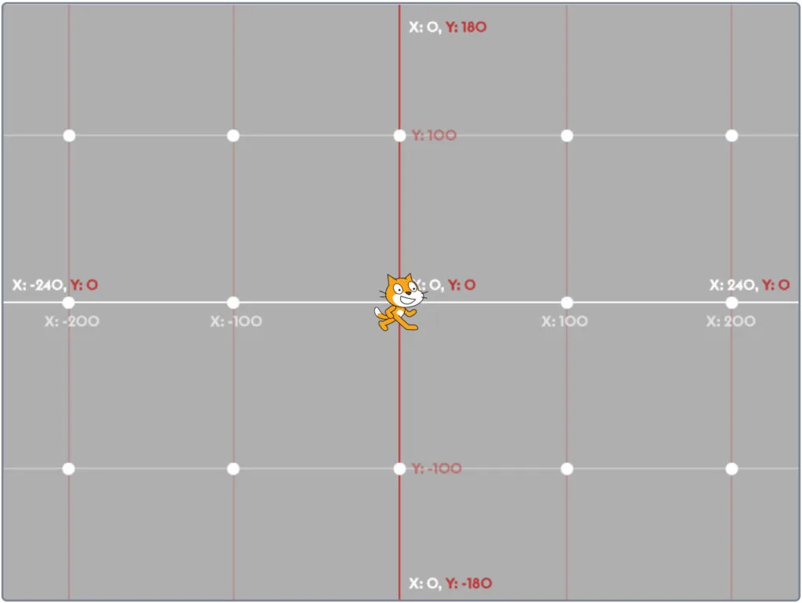
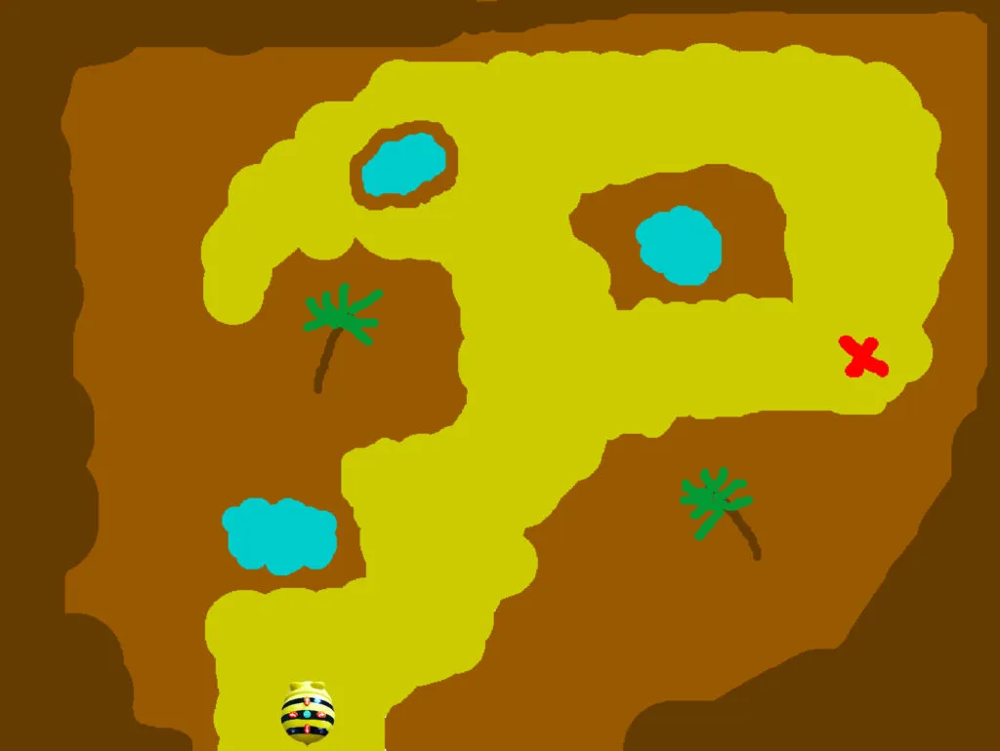
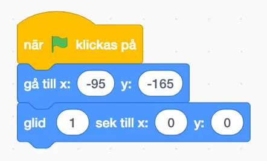
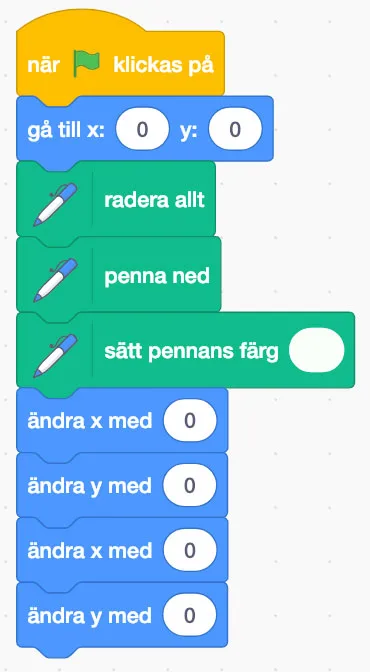

## Material

Digitala enheter för arbete i Scratch samt dina bästa läroplansglasögon.

## Koordinatsystem - Scratch {.steg}

**Starta aktiviteten genom att gå igenom koordinatsystem, så att eleverna får en grundläggande förståelse. Därefter tittar vi på hur koordinatsystem fungerar i Scratch. Även om vi inte ser koordinatsystemet, så finns det där - och med hjälp av det så kan vi bestämma exakt vart vi vill att exempelvis våra sprajtar ska gå eller befinna sig.**
Mittpunkten på Scratch scen är koordinaterna 0, 0. X-axeln, den horisontella sträcker sig från -240 till 240, vänster till höger. Y-axeln sträcker sig från -180 till 180 nedifrån och upp.

I filmen nedan kan ni se ett enkelt program där sprajten glider till olika koordinater och sedan säger den koodinaten den är på.

:::video /media/video/kood.mp4

Vill ni titta på koden finns projektet på [https://scratch.mit.edu/projects/272189298/](https://scratch.mit.edu/projects/272189298/)

## Skattjakten {.steg}

**Vår gamle vän Bee-bot fick tag på en gammal skattkarta på en auktion. Alla trodde att kartan var ett skämt, så ingen ville ha den, men Bee-bot hade på känn att det kanske, kanske, kanske fanns en möjlighet att den var äkta.**
Efter många timmars seglats över havet så nådde den äntligen ön där skatten skulle finnas, utmarkerad med ett rött X på kartan. Ett problem dock... Bee-bot hade aldrig förstått det där med koordinater, så nu måste ni hjälpa den stackarn att hitta fram. Ni måste dock hålla er på den gula stigen! Det bruna på kartan är nämligen kvicksand - och det vet ju alla att det förstör kretsarna på små robotar.

#### Uppgift [A]

:::video /media/video/skattj1.mp4

Eleverna jobbar i par med denna uppgift.
**Låt eleverna öppna scratchprojektet på [https://scratch.mit.edu/projects/272203171/](https://scratch.mit.edu/projects/272203171/). Den grupp av kodblock som ser ut som på bilden härunder ska eleverna hjälpa till att slutföra, så att Bee-bot når skatten utan att nudda kvicksanden.**
Genom att använda koordinaterna som står på Skattkartan (nedan, under bilden) ska de mata in dessa med hjälp av ett flertal "*glid x sek till x: y:*"-block. Ett finns där redan, så eleverna får börja att mata in den första koordinaten där, för att fylla på med fler block.

Se till att eleverna lär sig felsöka sin kod om problem uppstår och dra gärna paralleller till bilden på Scratch koordinatsystem (som du hittar längre upp i denna aktivitet).

#### **Skattkartan**

1. X: -95 Y: -165
2. X: -102 Y: -129
3. X: -33 Y: -121
4. X: -35 Y: -48
5. X: 0 Y: -49
6. X: 16 Y: 128
7. X: 168 Y: 120
8. X: 169 Y: 19

:::fakta
begrepp: Stegvisa Instruktioner, Koordinatsystem, Symbolers användning, Felsökning
fokus: Koordinatsystem | Hur kan vi använda koordinatsystem för att styra grafiska figurer?
ålder: Åk 4, Åk 5
:::

#### Uppgift [B]

:::video /media/video/skattjakt2.mp4

Eleverna jobbar i par med denna uppgift.
**I den här uppgiften så står Bee-bot på koordinaten 0, 0. För att ta oss till skatten måste vi ändra värdena på de fyra sista blocken i koden nedan. Vi får inte lägga till några block eller byta plats på dem.**

Låt eleverna öppna scratchprojektet på [https://scratch.mit.edu/projects/272285035/](https://scratch.mit.edu/projects/272285035/)
Elevernas uppgift blir alltså att ta sig till skatten utan att nudda kvicksanden. Låt dem diskutera med varandra och uppskatta vilka värden som skulle kunna fungera innan de börjar prova sig fram. Hänvisa gärna till bilden på Scratch koordinatsystem längst upp i aktivitet.

**Uppgift [C]**
Här måste eleverna försöka att räkna ut och rapportera vilken koordinat de står på när de kommit fram till skatten. Diskutera i klassen hur eleverna har löst sin uppgift.

:::fakta
begrepp: Stegvisa Instruktioner, Koordinatsystem, Symbolers användning, Felsökning
fokus: Koordinatsystem | Hur kan vi använda koordinatsystem för att styra grafiska figurer?
ålder: Åk 4, Åk 5
:::
