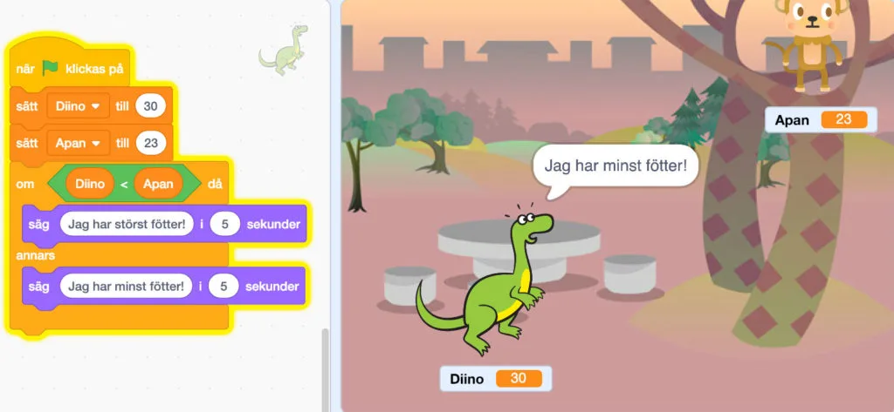

## Material

Digitala enheter för arbete i Scratch samt dina bästa läroplansglasögon.

## Villkor och felsökning {.steg}

I de följande uppgifterna fortsätter vi arbetet med villkor från årskurs 3. [Här hittar du den aktiviteten](/ak-3-nagot-i-vagen-robot-med-villkor/). Nytt gällande villkor blir att vi i Scratch använder **Om - Annars (If  - Else)**, där vi tidigare bara använt **Om**. Se till att eleverna vid felsökning går igenom sekvensen och gärna läser högt för sig själv vad som händer vid varje instruktion.
- "När GRÖN FLAGGA klickas på, OM det här är sant DÅ ska den göra såhär, ANNARS ska den göra på ett annat sätt..." och så vidare.
Ju mer avancerad vår kod blir, desto viktigare blir det att fokusera på just de stegvisa instruktionerna och att kunna läsa av vad som händer i sekvensen för att kunna felsöka.

## Knasiga villkor - vem har störst fötter? {.steg}

#### Uppgift [A]

**Diino har precis lärt sig att man kan jämföra saker och på så sätt veta om något är större än eller mindre än något annat. Just nu tycker hon att det är väldigt roligt att jämföra vem som har störst skostorlek, även om hon och hennes kompisar helst springer runt barfota.**

Någonting säger oss dock att hon inte riktigt förstått detta med större än och mindre än. Som ni ser i programmet här under så har Diino storlek 30 och kompisen Apan 23. Ändå så säger Diino att hon har minst fötter.

Eleverna jobbar i par i denna uppgift.
Nu är det upp till er att hjälpa Diino att förstå detta. Öppna scratchprojektet [https://scratch.mit.edu/projects/272643497/](https://scratch.mit.edu/projects/272643497/) och försök lösa problemet. Skostorlekarna har vi sparat i två variabler som heter Diino och Apan. Börja med att titta på koden och försök förstå vad som händer, steg för steg. Diskutera sedan med varandra och prova därefter att ändra i koden. Kan ni hitta två olika sätt att lösa det på?
Diskutera därefter lösningarna i klassen.

:::fakta
begrepp: Stegvisa Instruktioner, Villkor, Symbolers användning, Felsökning, Variabler
fokus: Villkor | Om ett villkor uppfylls händer en sak, annars en annan
ålder: Åk 4, Åk 5
:::

#### Uppgift [B]

**Nu är det dags att testa om er algoritm fungerar. Använd samma scratchprojekt som innan, men nu vill vi att ni använder blocket "slumptal 1 till 10" och slumpar fram en skostorlek till Diino och Apan varje gång ni kör programmet. Sätt slumptalet till mellan 20 och 30.**
Diskutera med varandra hur går tillväga och prova sen. Kör programmet minst 10 gånger och se om Diino säger rätt. Om inte, så får ni felsöka och prova igen.

**Om programmet slumpar fram samma skostorlek, vad händer då? Och varför? Diskutera detta i klassen.**

:::fakta
begrepp: Stegvisa Instruktioner, Villkor, Symbolers användning, Felsökning, Slump (Random), Variabler
fokus: Villkor | Om ett villkor uppfylls händer en sak, annars en annan
ålder: Åk 4, Åk 5
:::

#### Uppgift [C]

**Som ni märkt, så är vårt program inte riktigt anpassat för om Diino och Apan skulle ha samma skostorlek.**
Kan ni skriva om vårt program så att det fungerar för lika stora fötter samt se till att Diino säger att "vi har lika stora fötter"?
Diskutera i klassen hur ni har löst uppgiften.

:::fakta
begrepp: Stegvisa Instruktioner, Villkor, Symbolers användning, Felsökning, Slump (Random), Variabler
fokus: Villkor | Om ett villkor uppfylls händer en sak, annars en annan
ålder: Åk 4, Åk 5
:::
