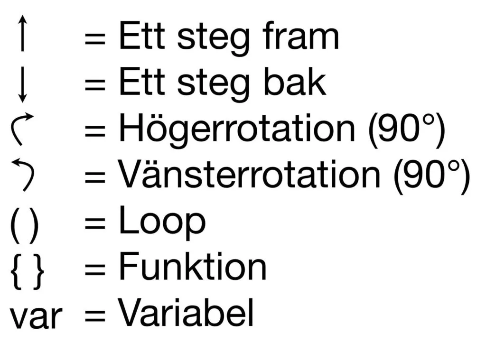
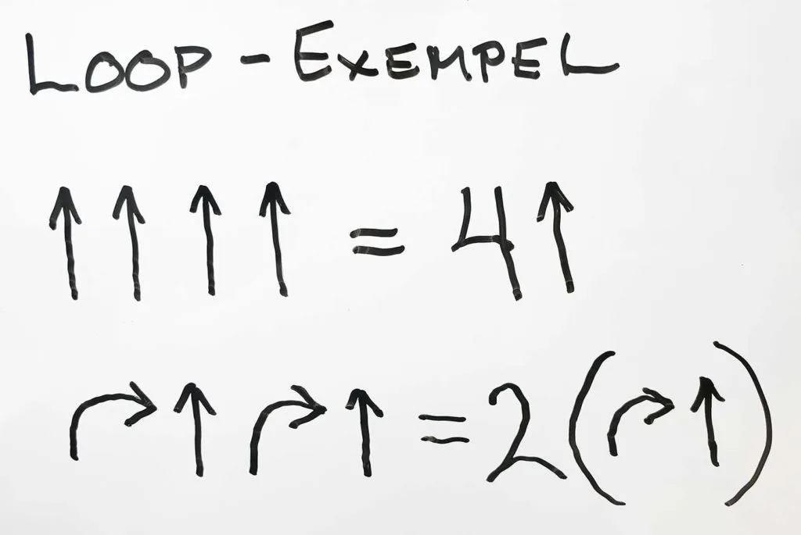
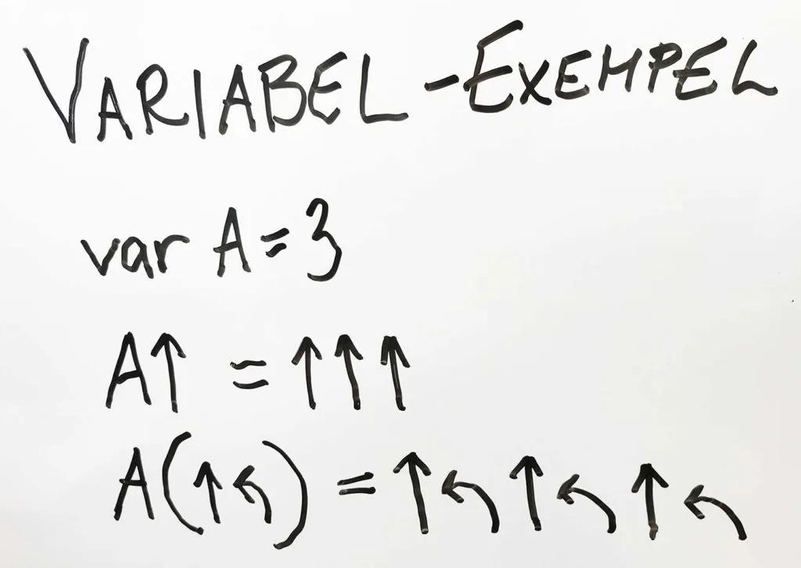
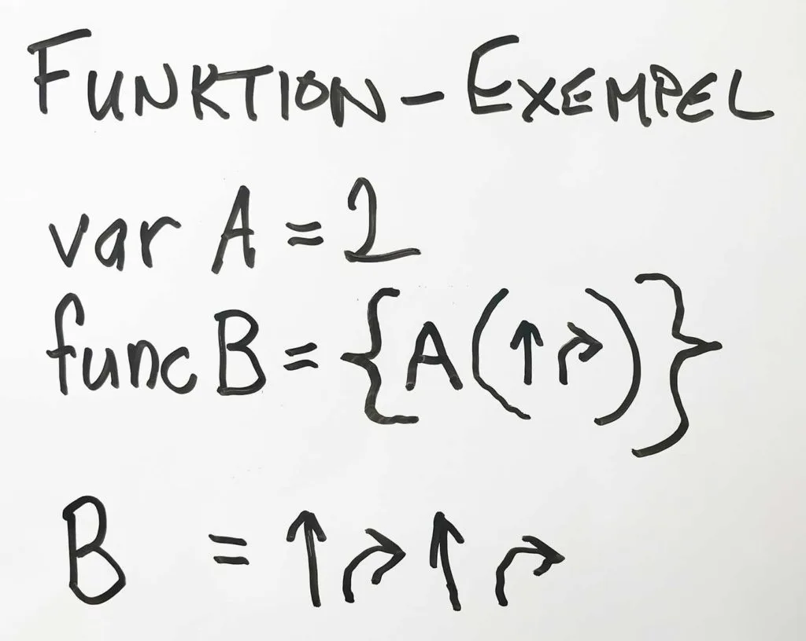
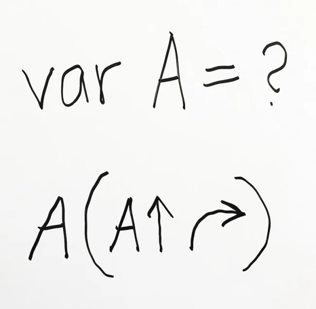
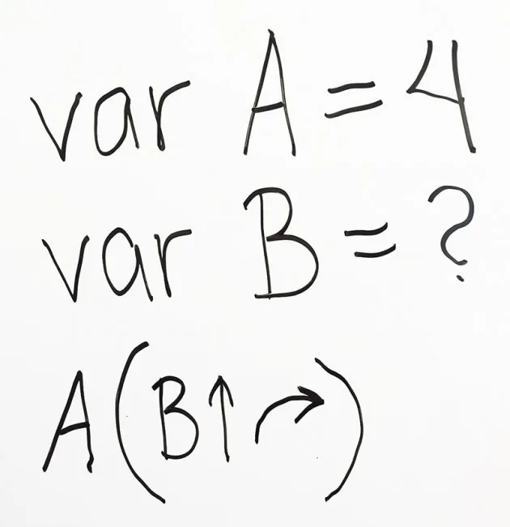
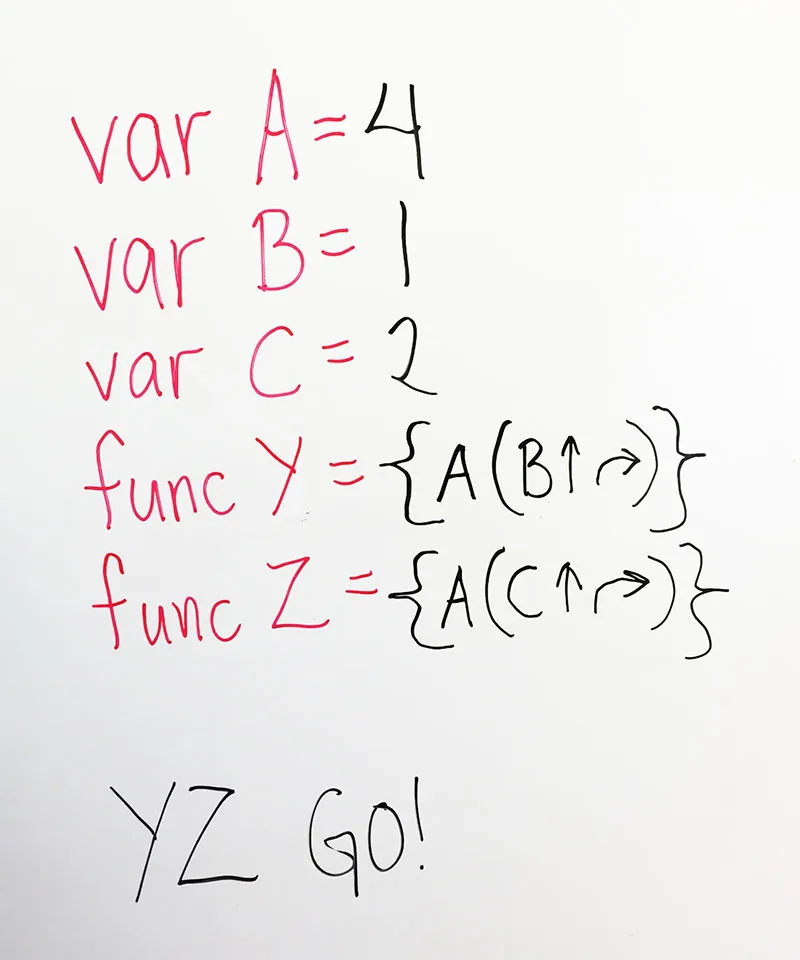

## Material

Penna, rutat papper, dina bästa läroplansglasögon och eventuellt Bee-Bots om ni vill testa koden fysiskt.

## Introduktion till Ansökningsprovet

**Kim har sökt till universitetet i Robotonia där hon vill läsa datavetenskap och få lära sig mer om programmering. För att komma in på den utbildningen så måste hon dock göra ett ansökningsprov. Med penna och papper! Nu ska även du få testa att göra det provet. För att komma in måste ni lösa både Del 1 och Del 2.
Lycka till!**

### Instruktioner till provet

Ni har väl inte glömt hur vi skrev Bee-bot-kod? Om ni har gjort det, så kommer här en liten snabbguide. Det som vi nu har lagt till är **Loop**, **Funktion** och **Variabel**. Funktion behövs inte för att klara av ansökningsprovet, utan är bara till för de som vill testa Genitestet.

#### Loop (repetition)

Om vi har kod som ska upprepas så kan vi, istället för att exempelvis skriva ut 4 stycken pilar som pekar upp, skriva siffran 4 följt av en pil upp. Vi loopar (repeterar) alltså pil upp 4 gånger.
Om vi har en kodsnutt med flera instruktioner som vi vill upprepa, kan vi sätta parentestecken kring det och ange en siffra framför, som i exemplet ovan där vi vill repetera *högerrotation - pil upp* två gånger.

#### Variabel

I en variabel, så kan vi som ni vet, lagra olika värden och data, som text och tal. I de här exemplen visar vi att vi skapar en variabel genom att skriva **var** följt av **namnet på variabeln = det vi vill lagra.** I exemplet i bilden ovan så har vi satt variabeln A till 3.

#### Funktion

Om vi har kodstycken som vi använder ofta kan vi skapa en funktion av detta och kalla på funktionen i stället för att skriva ut samma kod flera gånger.

## Ansökningsprovet - Del 1 {.steg}

**Eleverna jobbar i par i denna uppgift.**
Vilket värde kan variabeln A ha för att Bee-Bot ska röra sig så att den bildar en kvadratisk figur?
Diskutera med dina kamrater och ta hjälp av penna och papper om ni vill. Finns det flera lösningar? Vad gör variabeln A i de bägge fallen i algoritmen ovan? Varför? Förklara.

:::video /media/video/var-ak5-1.mp4

:::fakta
begrepp: Variabel, Loop (repetition), Stegvisa Instruktioner, Problemlösning, Symbolers användning
fokus: Problemlösning och variabler
ålder: Åk 4, Åk 5, Åk 6
:::

## Ansökningsprovet - Del 2 {.steg}

**Eleverna jobbar i par i denna uppgift.**
Vad händer om du ändrar variabeln B? Varför? Förklara.

:::fakta
begrepp: Variabel, Loop (repetition), Stegvisa Instruktioner, Problemlösning, Symbolers användning
fokus: Problemlösning och variabler
ålder: Åk 4, Åk 5, Åk 6
:::

## Ansökningsprovet - Genitestet {.steg}

**Den här uppgiften lämpar sig bäst till lite äldre elever, men om det är någon som vill testa, så låt dem.**
Vilken geometrisk figur kommer Bee-Bot att skapa? Kan du rita upp den på ett rutat papper? Kan du beskriva den geometriska figuren för dina kamrater? Vad händer om du ändrar variablerna? Kan du förklara det?

:::fakta
begrepp: Variabel, Loop (repetition), Stegvisa Instruktioner, Problemlösning, Symbolers användning, Funktion
fokus: Problemlösning
ålder: Åk 6, Åk 7
:::
