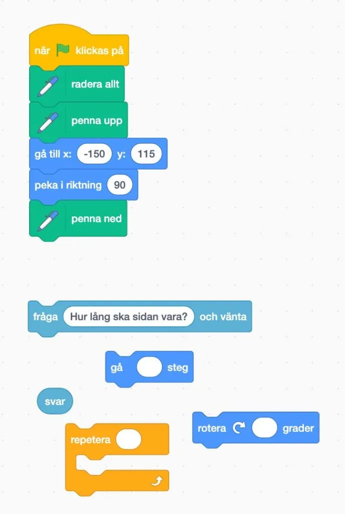

## Input output - vad är det?

Hittills när vi har jobbat med programmering, så har vi skrivit program som sköter sig själva utan inblandning av oss användare. Det kan exempelvis vara att katten Scratch ska röra sig 100 steg. Varje gång vi kör programmet, så rör sig Scratch 100 steg. I den här uppgiften vill vi att programmet, varje gång vi kör det, frågar dig som användare hur långt Scratch ska röra sig. Programmet tar in ett input från dig som användare. Och det som kommer ut, output visas upp på skärmen. Samma program ger dig alltså olika output beroende på vilket input det får.
Andra varianter av input, skulle kunna vara en ljussensor, som tänder en lampa om ljuset är för svagt i rummet. Eller en sensor som känner av ljud, avstånd eller annat.

## Material

Digital enhet, Scratch och dina bästa läroplansglasögon.

## Introduktion till del 2 av ansökningsprovet {.steg}

**Kim klarade den första delen av intagningsprovet till datavetenskapsprogrammet på universitetet i Robotonia. Men det är inte slut där. Nu är det dags för henne och er att lösa några programmeringsuppgifter i Scratch där vi ska få sprajten Scratch att rita upp olika former av geometriska figurer.**

### Instruktion till provet

På [https://scratch.mit.edu/projects/337068089](https://scratch.mit.edu/projects/337068089) kommer ni hitta en programmeringsyta som innehåller det ni ser i bilden nedan. För att vi ska kunna rita använder vi pennverktyget i Scratch. Halva koden är redan klar (översta hälften) och ser ut som följande i bilden:
När grön flagga klickas på, så raderar programmet allt som ritats tidigare, lyfter upp pennan från ytan och går till koordinaterna -150, 115. Där ställer sig Scratch och pekar i 90 graders riktning och sätter ned pennan på ytan, redo att rita!

### Uppgift [A]

:::video /media/video/4horn2.mp4

Det första vi vill göra är att Scratch ritar en kvadratisk rektangel. Dock så ska Scratch fråga användaren om hur lång sidan ska vara. Det svaret (som är en variabel och ett input) ska sedan användas för att styra längden på sidan, det vill säga hur långt Scratch ska gå.

Sätt ihop programmet så att det fungerar. Hur många grader måste Scratch rotera? Hur många repeteringar måste Scratch göra?

### Uppgift [B]

:::video /media/video/5horn2.mp4

I uppgift B vill vi nu att Scratch ska rita upp en femhörning och även en sexhörning. Hur gör vi då? Hur många grader måste Scratch rotera då? Funkar det fortfarande med 4 repeteringar?

:::video /media/video/6horn2.mp4

## Genitestet - Extra uppgift {.steg}

I den här extrauppgiften vill vi att ni får programmet att fråga oss om längd på sidan, antal grader och antal hörn. Det innebär att ni måste skapa variabler och lägga in svaren i variablerna. Använd samma scratchgrund som i den tidigare uppgiften.
Kan någon lösa detta?

:::video /media/video/xtra502.mp4
