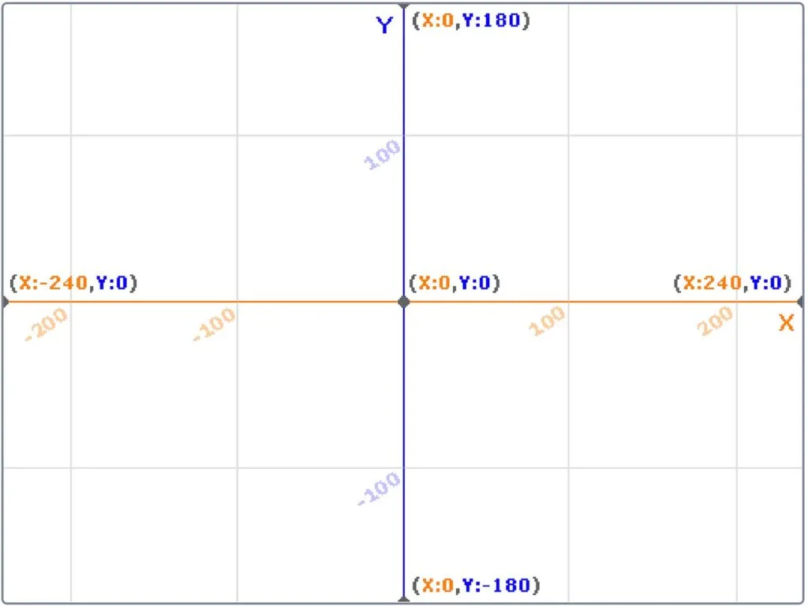
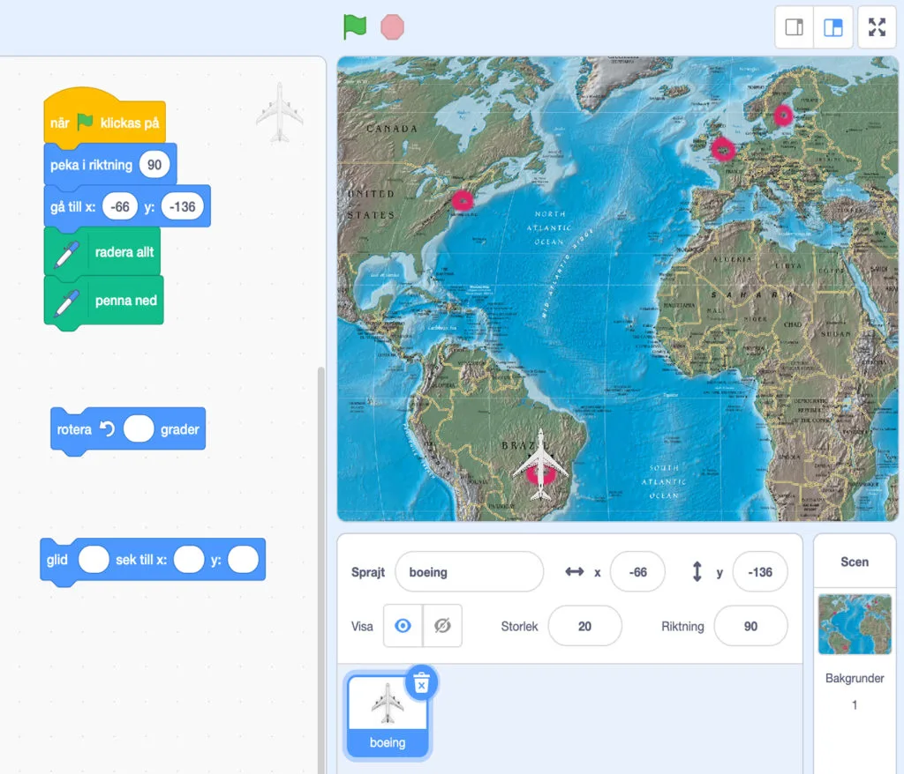
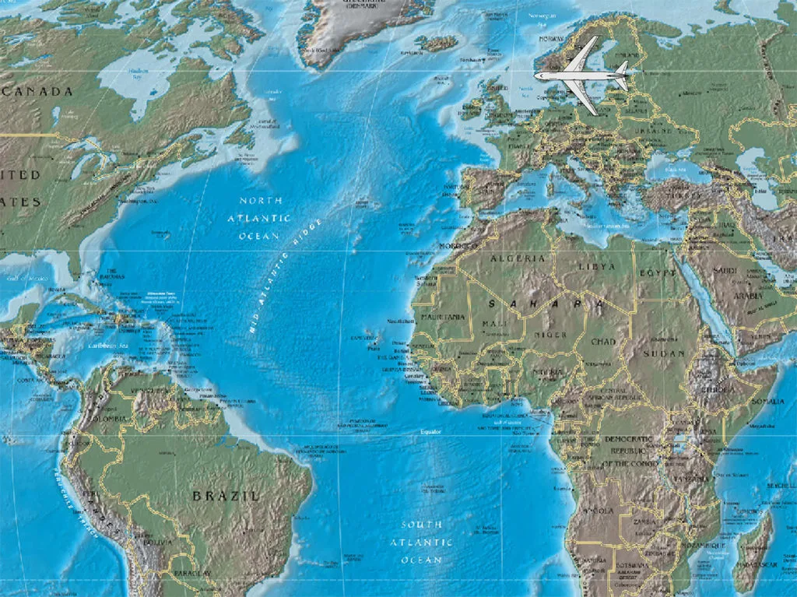

## Material

Digitala enheter för arbete i Scratch samt dina bästa läroplansglasögon.

## Koordinatsystem i Scratch

För att styra var sprajtar är någonstans och vart de ska i Scratch, så ser koordinatsystemet ut som på bilden nedan. X-axeln går från -240 (vänster) till 240 (höger) och Y-axeln från 180 (topp) till -180 (botten). Koordinaten 0, 0 är alltså i mitten.

#### Uppgift [A] - Flight plan 1

Förutom att Kim söker in till Universitetet, så är hon riktigt sugen på att lära sig flyga och bli pilot. Därför läser hon en kvällskurs där hon lär sig grunderna i att flyga. Ett av testerna är att skapa en flight plan, det vill säga planera ut en rutt som ett flygplan ska flyga enligt. Det här behöver hon er hjälp med - och tillsammans med Kim får ni programmera in rutten så att planet kan flyga på autopilot med hjälp av GPS.

Eleverna får nedanstående projekt på [https://scratch.mit.edu/projects/361475001](https://scratch.mit.edu/projects/361475001) där deras jobb blir att se till att:
1. flygplanet flyger enligt rutten: Brasilia, Brasilien >> New York, USA >> London, England >> Stockholm, Sverige
2. Vi använder oss av blocket "glid x sek till x: och y:" och hela resan ska ta exakt 10 sek
3. Nosen på planet måste alltid peka åt det håll som planet flyger.

I filmen nedan ser ni hur det ska se ut när ni är klara.

:::video /media/video/resa1.mp4

Avsluta med att diskutera i klassen hur eleverna gjort för att lösa uppgiften. Testade de sig fram med koordinaterna? Var det svårt? Lätt?

:::fakta
begrepp: Stegvisa Instruktioner, Koordinatsystem, Symbolers användning, Felsökning
fokus: Koordinatsystem | Hur kan vi använda koordinatsystem för att styra grafiska figurer?
ålder: Åk 5, Åk 6
:::

#### Uppgift [B] - Flight plan 2

I denna andra, lite svårare uppgift blir det elevernas tur att planera en resa från Sverige till Kanada. Dock har de bara bränsle i planet för att kunna ta sig 100 steg per flygning på X-axeln innan de måste ned och landa.

Låt eleverna använda projektet på [https://scratch.mit.edu/projects/361483052](https://scratch.mit.edu/projects/361483052) för att skapa sin egna flight plan, enligt samma regler som ovan (nosen åt rätt håll, glid-blocket samt att rutten ska ritas ut).

Diskutera och låt eleverna visa sina lösningar och hur de tänkt samt hur de räknat ut var de var tvungna att landa för att ta sig hela vägen fram.

:::fakta
begrepp: Stegvisa Instruktioner, Koordinatsystem, Symbolers användning, Felsökning
fokus: Koordinatsystem | Hur kan vi använda koordinatsystem för att styra grafiska figurer?
ålder: Åk 5, Åk 6
:::
