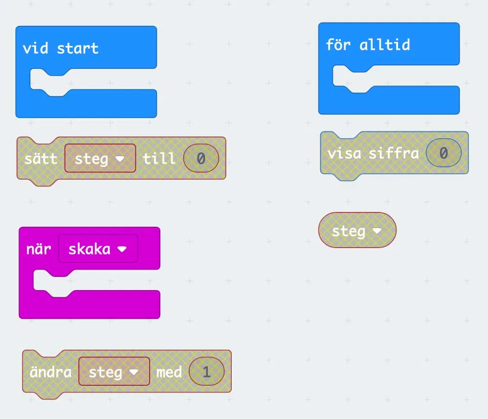

## Material

Micro:Bit, batteripack, digital enhet och dina bästa läroplansglasögon.

## Stegräknare {.steg}

**Hälso- och fritidsförvaltningen i Robotonia behöver din hjälp med att lösa två problem. Eftersom att vi människor behöver röra på oss för att må bra, har Robotonia köpt in hårdvara till stegräknare. På så sätt kan vi göra det lite roligare för oss att röra på oss, men vi kan även se hur pass mycket vi rör på oss.**
Men... de har glömt att köpa in mjukvaran till dessa, så nu fungerar de inte alls. Därför har de hört av sig till oss och vill att vi skapar mjukvaran till dessa stegräknare. Som tur är finns det en instruktionsmanual till hur vi kan koda detta. Så nu ska vi försöka följa den manualen.

#### Uppgift [A]

:::video /media/video/mbit1.mp4

**Robotonia vill ha en enkel stegräknare. Varje gång stegräknaren känner av en skakning, så ska den visa en siffra på skärmen som ökar med +1 för varje ny skakning.**
Nu är det upp till er att programmera den. Eleverna jobbar i par i uppgiften och följer instruktionerna. I bilden nedan ser ni de block vi kommer att använda för uppgiften.

**Elevernas instruktioner att följa där fetstilad text är namnen på blocken:**

1. Öppna [makecode.microbit.org](https://makecode.microbit.org)
2. Skapa en **variabel** som heter **steg**.
3. Välj ett **grundläggande** block som gör att **vid start** så **sätter vi variabeln steg till 0**, så att stegräknaren är nollställd varje gång vi sätter på den.
4. Välj ett **input** block där vi **när skaka**, alltså när vi skakar på Micro:bit, **ändrar variabeln steg med 1**. Då kommer värdet i variabeln steg öka med +1 varje gång den skakas.
5. Eftersom vi vill visa på Micro:bitens skärm hur många steg vi gått, måste vi med ett **grundläggande** block **för alltid** - **visa** **siffra**, **variabeln steg**. Eftersom värdet i variabeln steg hela tiden ökar när du går, så vill du ju med detta skapa en loop som visar upp det senaste värdet på skärmen.

Se till att prova koden i din webbläsare innan du för över den till din riktiga Micro:bit och testar i verkligheten.

:::fakta
begrepp: Input / Output, Stegvisa Instruktioner, Symbolers användning, Repetition, Variabler
fokus: Input / Output | Hur kan vi använda input via sensorer för att styra program?
ålder: Åk 5, Åk 6
:::

#### Uppgift [B]

:::video /media/video/mbit2.mp4

**Attans också! Vi glömde ju att vi också vill ha möjligheten att kunna nollställa stegräknaren utan att behöva stänga av vår Micro:bit och sätta på den igen.
Eleverna fortsätter att jobba i par i denna uppgift.**

Hitta på och programmera en lösning som gör att vi nollställer räknaren när vi trycker på **knapp A** på Micro:bit.

:::fakta
begrepp: Input / Output, Stegvisa Instruktioner, Symbolers användning, Repetition, Variabler
fokus: Input / Output | Hur kan vi använda input via sensorer för att styra program?
ålder: Åk 5, Åk 6
:::

## Tärning {.steg}

**Nu när avdelningen för hälsa har fått sin önskan genomförd med sin stegräknare är det dags att lösa den andra uppgiften, att hjälpa avdelningen för fritid att koda en tärning så att vi kan spela lite.**
Eftersom vi har hårdvara som vi kan programmera är det ju bara dumt att använda den till en sak, eller hur? Tänk om du bara kunde använda din mobiltelefon till att ringa?

#### Uppgift [A]

:::video /media/video/mbit3.mp4

**Nu är det upp till er att programmera er tärning. Eleverna jobbar i par i uppgiften och följer instruktionerna. Varje gång vi skakar på vår tärning så ska en slumpvald siffra mellan 1-6 visas.**
Här visar vi inga block, utan eleverna får följa instruktionen och leta samt pröva sig fram bland blocken. Dock heter blocken det som står som fetstilat i instruktionen.

**Elevernas instruktioner att följa där fetstilad text är namnen på blocken:**

1. Öppna [makecode.microbit.org](https://makecode.microbit.org)
2. Välj det **grundläggande** blocket **när skaka**
3. Nu när vi fått input i form av skakning, så vill vi **visa siffra** på skärmen.
4. Eftersom vi inte vill visa samma siffra varje gång, vill vi ju visa **välj slumpmässigt mellan 1-6**

Se till att prova koden i din webbläsare innan du för över den till din riktiga Micro:bit och testar i verkligheten.

#### Uppgift [B]

:::video /media/video/mbit4.mp4

**Nu är det dags att utöka funktionaliteten i vår tärning. Ditt uppdrag blir nu programmera din tärning så att:**

1. Det slumpas fram och visas ett tal på skärmen mellan 1-6 när du trycker på knapp A
2. Det slumpas fram och visas ett tal på skärmen mellan 2-12 när du trycker på knapp B
