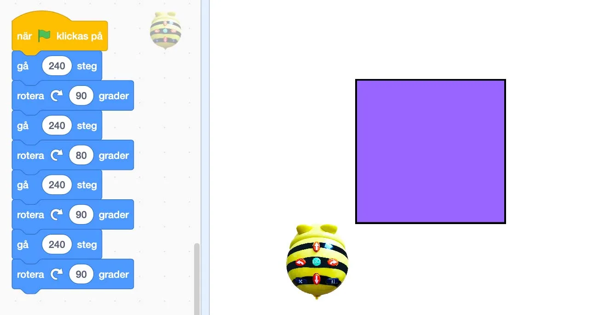
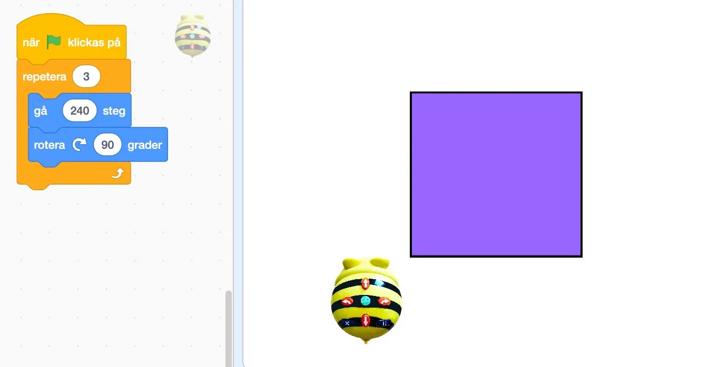
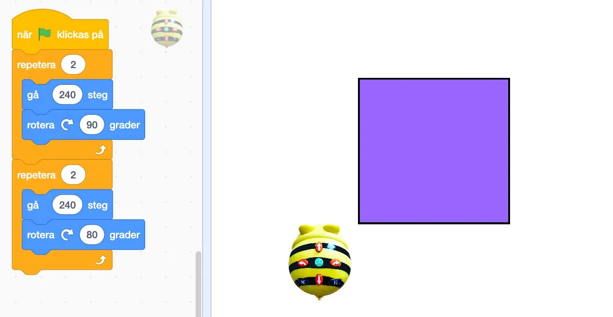
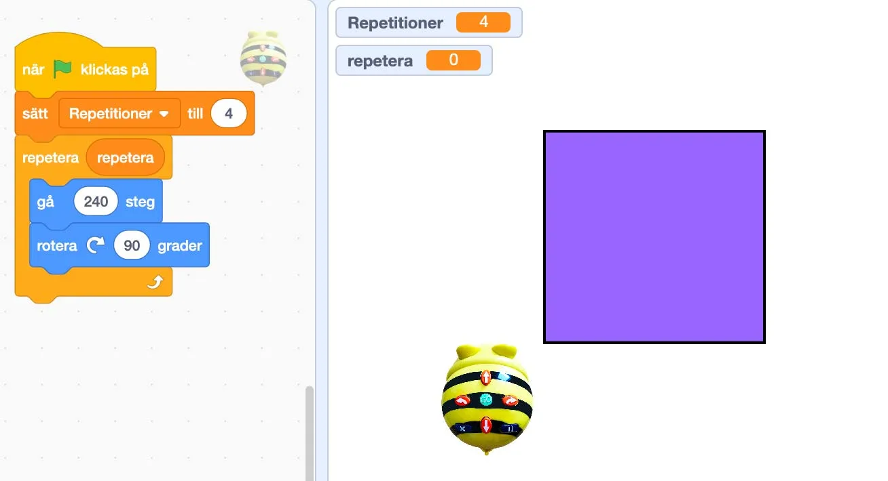
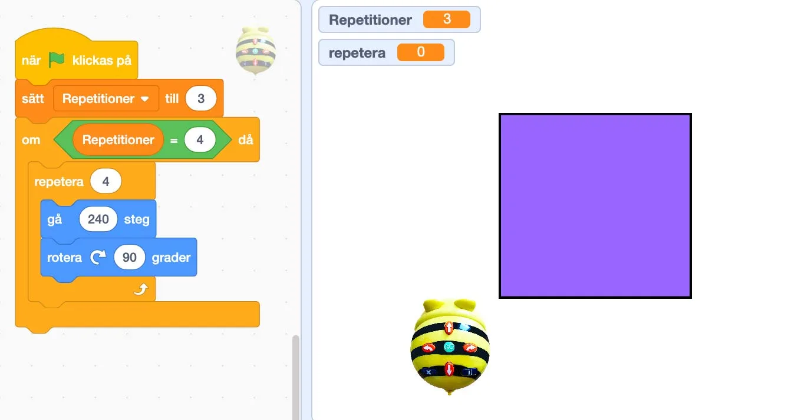

## Fem buggiga Bee-bots!

Kims kompis Charlie har fått jobb på ett företag där man reparerar trasiga robotar. Idag har Charlie fått in 5 stycken Bee-bots som inte fungerar.
Det som Bee-boten ska göra är att **röra sig i en kvadratisk figur (runt den lila kvadraten)** och stanna där den startade, men ingen av dessa gör det. Något är fel! Kan du hjälpa Charlie att fixa buggarna i koden? Programspråket som Bee-bot är programmerade i är Scratch.

Låt eleverna jobba i grupper om 2-4 personer. Diskutera därefter lösningarna tillsammans. Vad skulle behöva förändras för att koden ska fungera?

[Vill du, så kan du ladda ned en PDF här med alla uppgifterna om du vill skriva ut åt eleverna.](/media/doc/ak5-aktivitet-05.pdf)

## Material

Penna, papper och dina bästa läroplansglasögon.

### Felprogrammerad Bee-bot [A]

### Felprogrammerad Bee-bot [B]

### Felprogrammerad Bee-bot [C]

### Felprogrammerad Bee-bot [D]

### Felprogrammerad Bee-bot [E]

:::fakta
begrepp: Stegvisa Instruktioner, Felsökning, Symbolers användning, Villkor, Repetition, Variabler
fokus: Felsökning
ålder: Åk 5, Åk 6
:::
