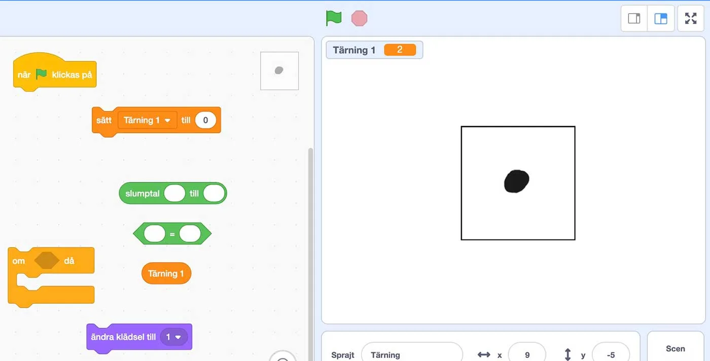
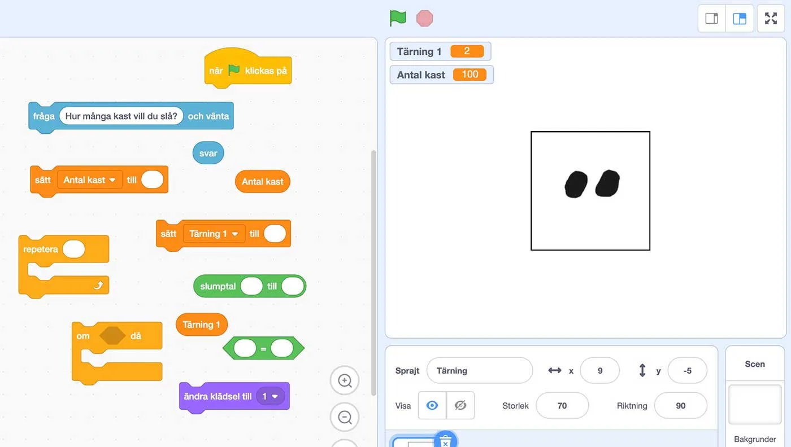

## Simulera tärningskast

Nu är det dags att börja fundera kring när det kan vara värt att skriva kod för att lösa matematiska problem. Ett sådant problem kan exempelvis vara att beräkna medelvärdet av tärningskast. Om vi vill beräkna medelvärdet av 10 tärningskast så kan vi givetvis göra det manuellt. Men vad händer om vi vill testa 100 eller 1000 tärningskast? Här kan vi använda oss av slumpen och simulera tärningskast.

I de tre uppgifterna går vi från att skapa en visuell representation av ett tärningskast till ett färdigt program som frågar användaren hur många tärningskast den vill slå, simulerar dessa och beräknar medelvärdet automatiskt.
Uppgifterna ställer dessutom lite högre krav på eleverna gällande deras kunskaper inom Scratch, såväl som deras problemlösningsförmåga.

### Uppgift [A]

Eleverna jobbar i par och öppnar projektet [https://scratch.mit.edu/projects/361765985](https://scratch.mit.edu/projects/361765985)
Där finns en tärningssprajt med 6 olika kostymer, en för varje sida på tärningen. Med hjälp av de block som ligger i programmeringsvyn ska de skapa ett program som när vi klickar på grön flagga:

- Slumpar fram ett tal mellan 1-6 (tärningskast) och sparar det värdet i variabeln *Tärning 1*.
- Med hjälp av villkor och operatorer byter kostym så att rätt sida på tärningen visas.

I filmen nedan ser ni hur det ska se ut.

:::video /media/video/dice1.mp4

Diskutera sedan i helklass hur eleverna har löst uppgiften.

:::fakta
begrepp: Stegvisa Instruktioner, Symbolers användning, Villkor, Variabler, Slump
fokus: Simulering och slump
ålder: Åk 6, Åk 7, Åk 8
:::

### Uppgift [B] - Input och antal kast

I den här uppgiften bygger vi ut tidigare program genom att vi frågar användaren hur många tärningskast den vill göra och sedan utför det antalet kast.
Eleverna jobbar i par och öppnar projektet [https://scratch.mit.edu/projects/361768721](https://scratch.mit.edu/projects/361768721) eller utgår från deras tidigare program i uppgift A.
Med hjälp av de block som ligger i programmeringsvyn ska de skapa ett program som när vi klickar på grön flagga:

- Frågar användaren hur många kast de vill slå.
- Sparar det värdet i variabeln *Antal kast.*
- Med hjälp av villkor och operatorer byter kostym så att rätt sida på tärningen visas.
- Repeterar tärningskastandet det antal gånger som är lagrat i *Antal kast.*

I filmen nedan ser ni hur det ska se ut.

:::video /media/video/dice-b1.mp4

Diskutera därefter i helklass hur eleverna har löst uppgiften.

:::fakta
begrepp: Stegvisa Instruktioner, Symbolers användning, Villkor, Variabler, Slump, Input / Output, Repetition
fokus: Simulering och slump
ålder: Åk 6, Åk 7, Åk 8
:::

### Uppgift [C] - Räkna ut medelvärde

I den sista uppgiften är det dags att sy ihop de tidigare uppgifterna och utöka funktionaliteten i programmet så att den lagrar summan av tärningskasten och när programmet repeterat klart tärningskasten så beräknar den medelvärdet.
I filmen nedan ser du hur det är tänkt att fungera.

:::video /media/video/dice-c1.mp4

Diskutera först tillsammans i helklass hur man beräknar medelvärde och brainstorma kring hur eleverna tror att de skulle kunna lösa uppgiften. Kommer de att behöva fler variabler? Kan man ändra värdet i en variabel? Du som lärare får välja hur mycket du vill hjälpa dina elever baserat på hur säkra de känner sig. I projektet på [https://scratch.mit.edu/projects/361769930](https://scratch.mit.edu/projects/361769930) hittar **du som lärare** det färdiga programmet.

Eleverna jobbar i par. Till den här uppgiften får de använda sig av sitt tidigare program från uppgift B och bygga vidare på det. När vi klickar på grön flagga så:

- Frågar användaren hur många kast de vill slå.
- Sparar det värdet i variabeln *Antal kast.*
- Med hjälp av villkor och operatorer byter kostym så att rätt sida på tärningen visas.
- Repeterar tärningskastandet det antal gånger som är lagrat i *Antal kast.*
- Ändrar och lagrar värdet av varje tärningskast i en variabel.
- Beräknar medelvärdet med hjälp av variablerna för antal kast och summan av tärningskasten och spar detta värde i en egen variabel.

Låt elevparen hjälpa varandra och inspireras av sina kamraters lösningar.

:::fakta
begrepp: Stegvisa Instruktioner, Symbolers användning, Villkor, Variabler, Slump, Input / Output, Repetition, Problemlösning
fokus: Simulering och problemlösning
ålder: Åk 6, Åk 7, Åk 8
:::
