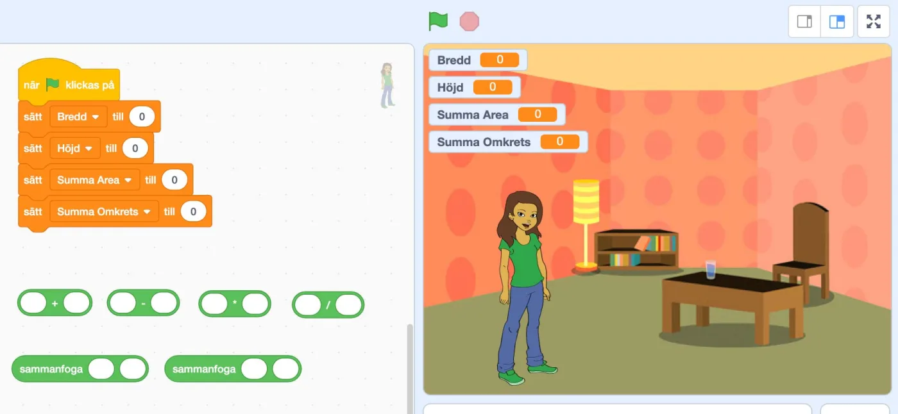
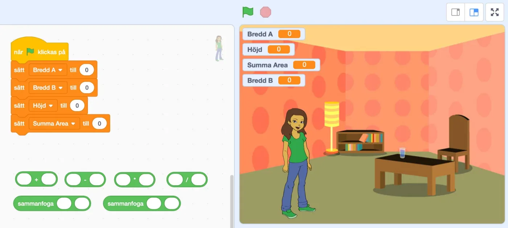

## Lägga nytt golv och tapetsera

Kim har sparat sin lön i ett par månader nu för att kunna lägga nytt golv samt tapetsera i sin lägenhet. Dessutom ska hon även sätta upp nya golvlister. För att veta hur mycket tapet, golv samt golvlister hon behöver, kommer hon behöva räkna ut area och omkrets. Flera gånger. Givetvis så skriver Kim ett eget program som räknar ut detta. Tillsammans med er.

### Uppgift [A] - Golv och golvlister

I denna första uppgift så ska ni skapa ett enkelt program där ni matar in bredd och höjd i respektive variabel. När ni sedan trycker på *grön flagga* ska programmet räkna ut area och omkrets med hjälp av de variablerna.
Dessutom får vi tänka på att när vi räknar med decimaltal i programmering så använder vi inte kommatecken (exempelvis 3,5) för att ange decimaler, utan punkt (exempelvis 3.5).

Eleverna jobbar i par och får använda sig av blocken i projektet. Alla block behöver inte användas och vill de, så får de komplettera med fler. Projektet hittar ni på [https://scratch.mit.edu/projects/362688036](https://scratch.mit.edu/projects/362688036)

**När deras program är klart, låt eleverna räkna ut följande med hjälp av det:**

1. Kims golv är 5,6 meter långt på ena ledden och 3,2 på den andra. Hur många kvadratmeter golv måste Kim köpa?
2. Hur många meter golvlist måste Kim köpa?
3. Kontrollräkna med penna och papper för att se om er algoritm stämmer. Stämmer svaren från erat program överens med er kontrollräkning?

Låt eleverna visa upp sina lösningar och diskutera hur de gjort för att räkna ut area respektive omkrets.

:::fakta
begrepp: Stegvisa Instruktioner, Symbolers användning, Variabler, Problemlösning
fokus: Problemlösning
ålder: Åk 6, Åk 7
:::

### Uppgift [B] - Tapeter

Nu när vi vet hur mycket golv vi måste köpa, vill vi även veta hur mycket tapet vi måste köpa. Vi skapar ett nytt program där vi vill att programmet räknar ut den totala arean av alla fyra väggarna, genom att vi matar in bredden (Bredd A och Bredd B) för de bägge väggarna samt höjden. När vi trycker på grön flagga så ska den totala arean räknas ut och visas i variabeln *Summa Area*.

Eleverna jobbar i par och använder sig av projektet på [https://scratch.mit.edu/projects/362699560](https://scratch.mit.edu/projects/362699560)

**När deras program är klart, låt eleverna räkna ut följande med hjälp av det:**

1. Rummet består av fyra väggar, där två av väggarna vardera är 5,6 meter långa och de två andra väggarna vardera är 3,2 meter långa. Höjden från golv till tak är 3,8 meter. Hur många kvadratmeter tapet måste Kim köpa?
2. Kontrollräkna med penna och papper för att se om er algoritm stämmer. Stämmer svaren från erat program överens med er kontrollräkning?

Låt eleverna visa upp sina lösningar och diskutera hur de gjort för att räkna ut area respektive omkrets.

:::fakta
begrepp: Stegvisa Instruktioner, Symbolers användning, Variabler, Problemlösning
fokus: Problemlösning
ålder: Åk 6, Åk 7
:::

### Uppgift [C] - Golv, väggar och kostnad

I denna svåra extrauppgift blir det nu din uppgift att göra ett program av de tidigare. Dock så vill vi att du använder dig av input från användaren och att sprajten Kim frågar och svarar dig.
Det här kommer ställa stora krav på dig gällande problemlösning. Hur ska du lösa detta? I filmen nedan ser du ett exempel.

:::video /media/video/areac.mp4

Eleverna jobbar i par, och kan använda tidigare projekt som grund för denna uppgift.

När grön flagga klickas på, så ska Kim (sprajten) fråga användaren om den vill räkna ut area och omkrets för golv eller area för väggarna. Här får vi använda oss av villkor och förmodligen utöka med ett par variabler till. Eller?
Därefter ska Kim fråga användaren efter bredd och höjd och därefter säga vad summorna blir.
Försök lösa uppgiften eller en del av uppgiften. Dela sedan med varandra och titta på varandras lösningar. Uppgiften är relativt fri, så länge som beräkningarna stämmer.

Vill ni titta på en lösning av problemet (som i filmen ovan) finns den på [https://scratch.mit.edu/projects/362703637](https://scratch.mit.edu/projects/362703637)

:::fakta
begrepp: Stegvisa Instruktioner, Symbolers användning, Variabler, Problemlösning, Villkor, Repetition
fokus: Problemlösning
ålder: Åk 6, Åk 7, Åk 8
:::
