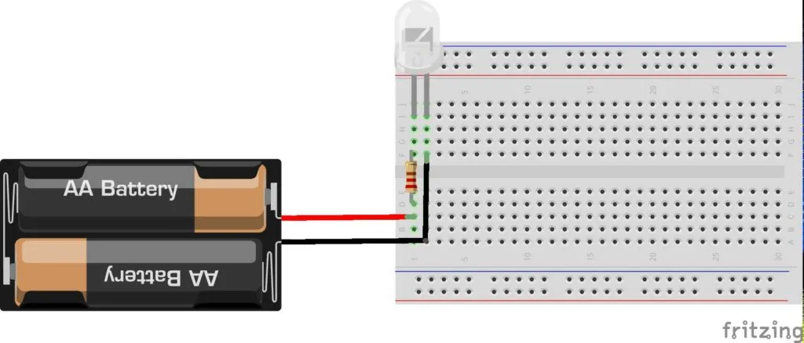
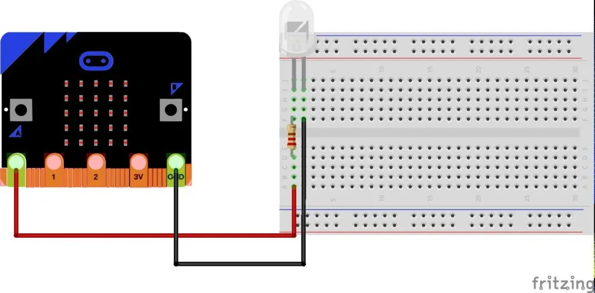
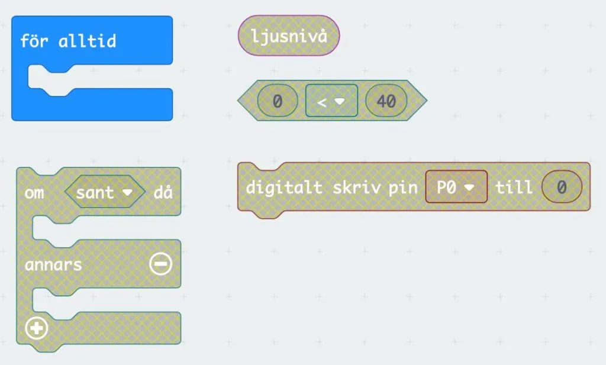

## Material

Kopplingsdäck, kablar, led-lampor, motstånd, Micro:bit samt dina bästa läroplansglasögon.

## Automatiserad kvällsbelysning {.steg}

:::video /media/video/micbit5.mp4

**På trafikkontoret i Robotonia jobbar Kim extra varje morgon och kväll med att slå på och stänga av gatubelysningen. Det passar Kim perfekt eftersom hon pluggar programmering på universitetet och då har en massa tid till att studera under dagarna. Dock har Kim funderat på om hon inte kan göra det här lite bättre genom att automatisera kvällsbelysningen i staden. Med hjälp av sensorer skulle belysningen kunna tändas när det behövs och inte klockan 17 varje kväll när hon kommer dit. På vintern blir det ju faktiskt mörkare tidigare och på sommaren senare.**
Hon blir lite orolig för att hon ska förlora sitt jobb, men förhandlar fram att Robotonia får använda hennes program för en summa pengar varje månad. Nu är det dags för henne att sätta igång och lösa problemet. Till sin hjälp vill hon ha er, så nu sätter vi igång.

#### Uppgift [A]

**Sätt ihop en prototyp för gatubelysningen. Här vill vi bara skapa en sluten krets, för att se att belysningen fungerar, så att vi vet det innan vi börjar programmera. Använd batteriet till Micro:biten som strömkälla.**

Visa eleverna vad som är + / - på led-lampan och varför ett motstånd används. Låt sedan eleverna testa att bygga ihop kretsen på kopplingsdäcket.

#### Uppgift [B]

**Nu när vi vet att vår belysning fungerar är det dags att byta ut batteriet mot vår Micro:bit. Sätt + till Micro:bitens PIN OUT 0 och jorden - till Micro:bitens GND (Ground). Vi kommer alltså att skicka ström från vår Micro:bit för att tända lampan när ljussensorn känner av att det blir för mörkt.**

**Låt eleverna jobba i par i denna uppgift. Blocken i bilden nedanför är de som vi ska använda i vår kod.**

**Elevernas instruktioner att följa där fetstilad text är namnen på blocken:**

1. Gå till [https://makecode.microbit.org](https://makecode.microbit.org)
2. Använda det **grundläggande** blocket **för alltid**, eftersom vi vill loopa att sensorn känner av ljusstyrkan hela tiden
3. I **för alltid** vill vi använda ett villkor, där vi vill ta reda på **om ljusnivå är mindre än** (siffra mellan **0-255**, där 0 är mörkast och 255 är ljusast)**, då ska vi digitalt skriv pin P0 till 1** (slår på strömmen och därmed lampan)
4. **Annars** vill vi **digitalt skriv pin P0 till 0** (slår av strömmen och därmed lampan)

Här måste ni testa er fram till vilket värde siffran i villkoret ska vara. När vill ni att lampan slås på? Testa koden i editorn i webbsidan först innan ni laddar ned koden till er Micro:bit.

:::fakta
begrepp: Input / Output, Stegvisa Instruktioner, Symbolers användning, Villkor, Repetition
fokus: Input / Output - Hur kan ett input styra ett output?
ålder: Åk 5, Åk 6
:::

#### Uppgift [C]

**Nu vill vi även att ni lägger till kod så att vi ser siffran 1 eller 0 på Micro:bitens LED-skärm om belysningen är på eller av.**
Prova er fram och lös uppgiften i par.

:::fakta
begrepp: Input / Output, Stegvisa Instruktioner, Symbolers användning, Villkor, Repetition
fokus: Input / Output - Hur kan ett input styra ett output?
ålder: Åk 5, Åk 6
:::
