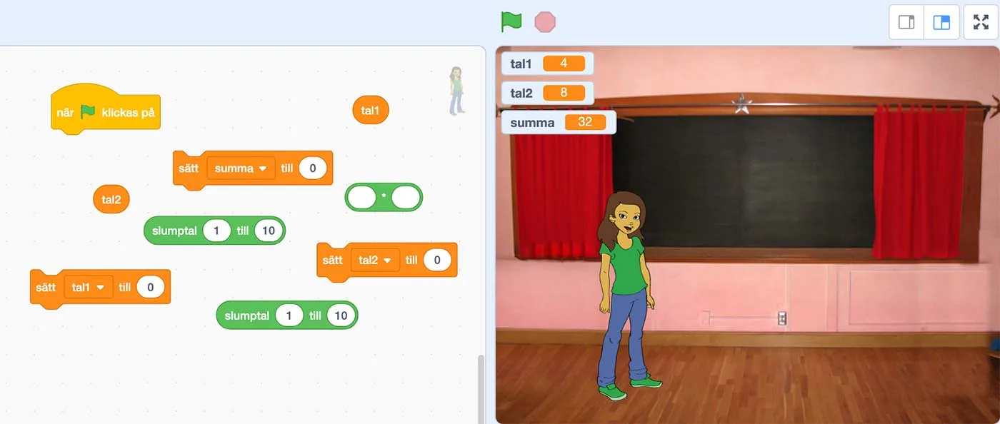
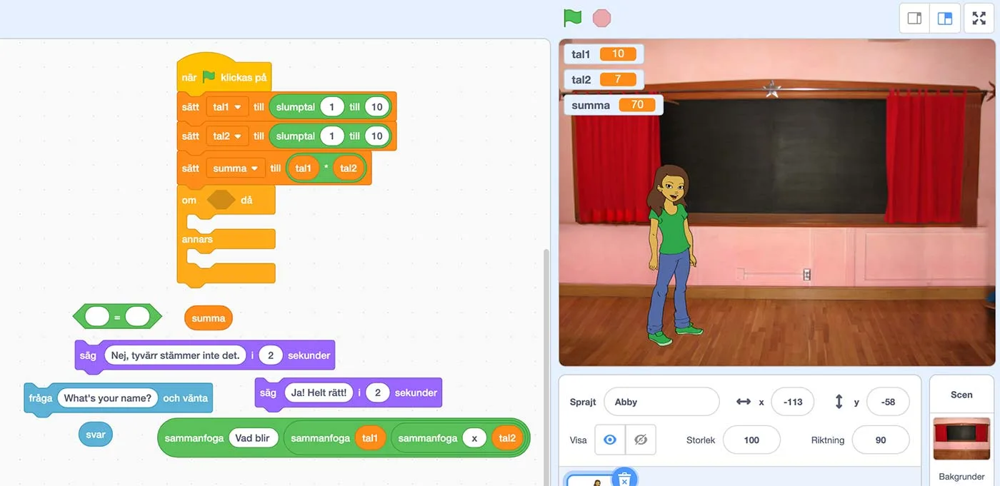

### Uppgift [A] - Grunden

Kims kompis Charlie har alltid känt sig lite svag på huvudräkning. Charlie vet att Kim är en klippa på att programmera och frågade henne för ett tag sedan om hon inte skulle kunna skriva ihop ett litet spel till honom, som hjälper honom att träna sig på just multiplikation. Självklart så vill Kim hjälpa Charlie, men istället för att bara skicka länken till spelet så skrev hon ihop en instruktionsmanual för hur Charlie kan göra det själv - och på köpet lära sig lite programmering.
Nu är det dags att vi testar Kims instruktionsmanual.

I denna första uppgift vill vi att eleverna följer instruktionerna för att skapa grunden till ett spel. Använd projektet i Scratch på [https://scratch.mit.edu/projects/362726612](https://scratch.mit.edu/projects/362726612)

#### Instruktioner

1. Skapa tre olika variabler och döp dessa till **tal1**, **tal2** och **summa**.
2. Dra ut tre variabel-block ***Sätt \*\*\* till 0*** (där \*\*\* är namnet på en variabel) och fäst dem direkt under **när grön flagga klicka på**-blocket.
3. Ändra **\*\*\*** i de tre variabel-blocken, så att det ena blocket visar **Sätt tal1 till 0**, det andra **Sätt tal2 till 0** och det sista till **Sätt summa till 0**.
4. Vi vill slumpa fram **tal1** och **tal2** varje gång programmet körs, så därför drar vi ut blocket **slumptal 1 till 10** och ersätter **0** i blocket **Sätt tal1 till 0**. Därefter gör vi samma sak och ersätter **0** i blocket **Sätt tal2 till 0**.
5. Nu **testar** vi programmet och startar det genom att klicka på **grön flagga**. Varje gång du klickar på grön flagga så ska ett tal mellan 1-10 slumpas fram, både i **tal1** och **tal2**.
Om det inte fungerar får du gå tillbaka och felsöka. Har du följt instruktionen till punkt och pricka?
6. Nu ska vi räkna ut summan av de två slumpade talen, tal1 och tal2, så vi använder **operator**-blocket för multiplikation där det är **två tomma hål med ett \*** (multiplikationstecken) mellan. Det blocket ska vi lägga in istället för **0** i **sätt summa till 0**.
7. I blocket ovan, där det stod **[tomt] \* [tomt]** ska vi nu lägga in våra variabler tal1 och tal2, så att det blir **tal1 \* tal2**.
8. Nu när detta är klart så testar vi vårt program igen. Varje gång vi klicka på **grön flagga** så ska **två tal slumpas** (mellan 1-10) fram och sparas i variablerna **tal1** och **tal2**. Därefter så sparas summan av **tal1 multiplicerat med tal2** i variabeln **summa**.
Fungerar det? Toppen! Om inte, gå tillbaka och felsök. Ta hjälp av en kamrat.

Nu kan det se ut som i filmen nedan, varje gång vi klicka på grön flagga.

:::video /media/video/mult1.mp4

:::fakta
begrepp: Stegvisa Instruktioner, Symbolers användning, Variabler, Problemlösning, Slump
fokus: Problemlösning
ålder: Åk 6, Åk 7
:::

### Uppgift [B] - Fråga Svar

Nu när vi har grunden till vårat spel, så är det dags att låta vår sprajt Kim fråga användaren vad det slumpade talet 1 multiplicerat med det slumpade talet 2 blir. Därefter så måste programmet kunna jämföra om användarens svar stämmer, det vill säga om svar är lika med variabeln summa.

Vi öppnar projektet på [https://scratch.mit.edu/projects/362724474](https://scratch.mit.edu/projects/362724474) där vi har fått lite hjälp på traven och alla block ligger ute. Nu följer vi instruktionerna och sätter ihop programmet.

#### Instruktioner

Vi fortsätter från där vi var sist, med skillnaden att ett villkorsblock är påkopplat, det som heter **om - då - annars**. Villkorsblocket ska testa om svaret som användaren ger är lika med svaret som är sparat i variabeln summa. **Om** det är sant, **då** ska något hända. **Annars**, om det inte är sant ska något annat hända.

1. Oj, nu blev det lite fel. Innan villkorsblocket **om - då - annars** behöver ju programmet ställa frågan vad tal1 multiplicerat med tal2 blir. Annars har vi ju ingenting att jämföra med.
Börja med att sätta in blocket **fråga What's.... och vänta** före **om - då - annars**.
2. I **fråga-blocket** står det ju nu **What's your name**. Det vill ju inte vi fråga. Vi vill ju fråga vad **tal1 x tal2** blir. För att sätta ihop en blandning av text och variabler och annat så kan man använda blocken **sammanfoga**. Ta en titt på hur Kim har gjort i det långa gröna blocket och dra sedan hela det blocket och ersätt **What's your name** med det.
3. Nu testar vi programmet. Om vi klickar på **grön flagga**, så ska två tal mellan 1-10 slumpas fram och sparas i variablerna tal1 och tal2. Dessa två tal multipliceras och summan sparas i variabeln summa.
Därefter frågar Kim användaren **Vad blir tal1 x tal2**.
Fungerade det? Bra! Om inte, gå tillbaka och felsök.
4. Nu kommer vi till villkoret. Här måste vi jämföra om **svar** är lika med **summa**, alltså om användarens svar är lika med summan som är sparad i variabeln summa. Här använder vi operatorn **[tomt] = [tomt]** och drar in variablerna **svar** och **summa** i de bägge tomma utrymmena.
5. **Om** det är sant att **svar är lika med summa**, så har ju användaren svarat rätt och då ska Kim säga **Ja! Helt rätt!** Dra in det prat-blocket under **Om**.
**Annars**, om det är fel, vill vi att Kim ska säga **Nej, tyvärr så stämmer inte det**. Dra in det prat-blocket under **Annars**.
6. Nu testar vi programmet och ser om det fungerar. Prova att svara rätt och fel och se om Kim svarar så som vi vill. Om det inte fungerar, gå tillbaka och felsök.

I filmen nedan ser ni hur det ser ut när vi är klara.

:::video /media/video/mult2.mp4

:::fakta
begrepp: Stegvisa Instruktioner, Symbolers användning, Variabler, Problemlösning, Villkor, Slump
fokus: Problemlösning
ålder: Åk 6, Åk 7
:::

### Uppgift [C] - Utöka programmet

Nu sitter vi med ett program som kan förhöra oss på multiplikationstabellerna. Tänk på att gömma variablerna när ni kör programmet, så att inte svaret syns.
Men hur skulle vi kunna vidareutveckla vårat program? Här kommer några förslag som ni kan testa.

#### Förslag

- Se till att programmet repeteras ett antal gånger, till exempel 10 gånger, så att vi slipper klicka på grön flagga varje gång för att få en ny fråga.
- Poängräkning. Skapa en variabel som heter poäng och ändra variabeln poäng med +1 vid varje rätt svar och -1 vid varje fel svar.
- Flera olika räknesätt? Kan vi ändra räknesätt? Eller blanda och ha flera olika räknesätt i samma program?

:::fakta
begrepp: Stegvisa Instruktioner, Symbolers användning, Variabler, Problemlösning, Villkor, Repetition, Slump
fokus: Problemlösning
ålder: Åk 6, Åk 7, Åk 8
:::
