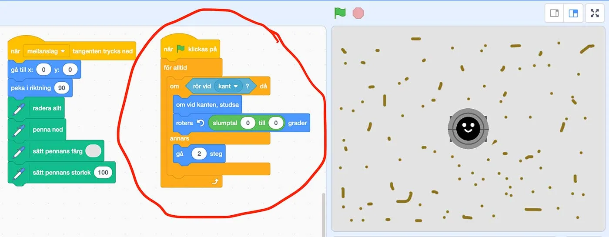
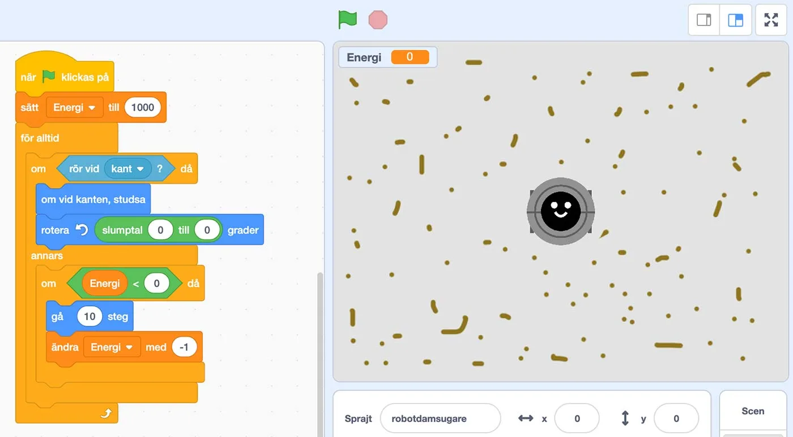

## Trasig robotdammsugare - dags för felsökning

**En dag när Kim gick ned till soprummet för att sopsortera, så tog hon en titt i elskrotlådan och hittade en EatDustRobo - en robotdammsugare. Den såg ut att vara i väldigt fint skick, så hon tog med sig den hem igen. Kanske kunde hon få den att fungera igen.**
När hon kom hem messade hon Charlie, som redan jobbar med robotar och bad honom ta en titt på den. Han kunde konstatera rätt snabbt att det inte var något fel på hårdvaran. Det måste vara mjukvaran det är fel på, vilket Kim blev glad över. Nu ska vi se om vi inte kan felsöka mjukvaran tillsammans och kanske till och med göra roboten ännu bättre.

### Uppgift [A] - Få dammsugaren att fungera

Något är fel med programvaran i vår EatDustRobo. I filmen nedan ser ni hur den ska röra sig när den fungerar. Ni ser även hur den rör sig nu.

:::video /media/video/robotdammsugare.mp4

Nu är det alltså dags att felsöka och försöka fixa mjukvaran. Det vi ska fokusera på är den delen i projektet som är inringad i rött i bilden nedan.

Starta programmet med **grön flagga** och nollställ smutsen och postitionen för roboten med **mellanslagstangent**.

Så här ser robotdammsugarens programvara ut. Eleverna kan öppna projektet på [https://scratch.mit.edu/projects/363413599](https://scratch.mit.edu/projects/363413599) och de ska jobba i par.

1. Eleverna ska först försöka klura ut vad koden gör. Låt dem skriva ned exakt vad varje kodblock gör i den ordning som programmet utför instruktionerna i. Vad verkar vara fel?
2. Hur ska de få roboten att fungera igen? Låt eleverna fixa felet och visa därefter upp elevernas olika lösningar. Låt dem beskriva vad deras förändringar i koden gör.
Hur får de roboten att gå snabbare / långsammare? Och varför gör roboten det?
Hur får de roboten att rotera? Är det bra med slump? Finns det bättre sätt?

:::fakta
begrepp: Stegvisa Instruktioner, Symbolers användning, Variabler, Problemlösning, Villkor, Repetition, Slump
fokus: Felsökning och problemlösning
ålder: Åk 6, Åk 7
:::

### Uppgift [B] - Batterimätare

En sak som Kim tycker är lite jobbigt är att hennes EatDustRobo helt plötsligt slutar att fungera för att batteriet är slut. Därför har hon byggt in en energimätare i mjukvaran. Tyvärr så är det väldigt sent på kvällen och hon har kört fast. Koden borde ju fungera, fast den gör inte det. Kan ni hitta vad som är fel? Det bör fungera som i filmen nedan.

:::video /media/video/roboupg2.mp4

Nu är det dags för er elever att vässa geniknölarna och försöka få programmet att fungera. Kim har lagt till en variabel för **Energi**, där en **full laddning är 1000**, vilket är det första värde som sätts när vi kör igång programmet. Därefter så ändrar vi variabeln Energi med **-1** för varje **gå 10 steg**, då det är så mycket batteri som går åt. Projektet hittar eleverna på [https://scratch.mit.edu/projects/363431051](https://scratch.mit.edu/projects/363431051)

1. Eleverna ska först försöka klura ut vad koden gör. Låt dem skriva ned exakt vad varje kodblock gör i den ordning som programmet utför instruktionerna i. Vad verkar vara fel?
2. Nu ska eleverna försöka reparera programmet. Varför står dammsugaren stilla när vi kör igång programmet?
3. Kan vi få dammsugaren att dammsuga hela rummet på en full laddning = 1000? Om inte, hur mycket energi skulle vi behöva för att lyckas de flesta gångerna? Finns det andra lösningar?
Låt eleverna visa upp sina lösningar och diskutera med varandra.

:::fakta
begrepp: Stegvisa Instruktioner, Symbolers användning, Variabler, Problemlösning, Villkor, Repetition, Slump
fokus: Felsökning och problemlösning
ålder: Åk 6, Åk 7
:::
