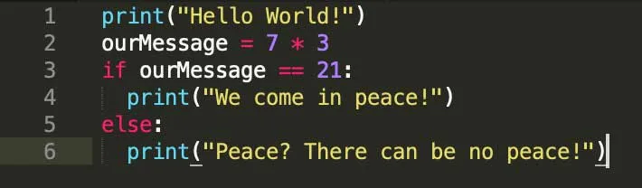
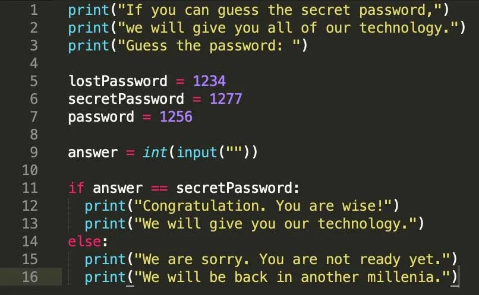

## Besök från planeten Python

**Kim, Charlie och Ruby hjälper [SETI (Search for ExtraTerrestrial Intelligence) Institute](https://seti.org) med att analysera signaler från deras radioteleskop i hopp om att någon dag få ett bevis på att det finns liv på andra planeter än jorden.**
Och just den här kvällen hände det. Ett meddelande. Tyvärr är meddelandet skrivet på ett språk som de inte förstår. Nämligen språket Python. Nu behöver de all hjälp de kan få med att tyda vad besökarna vill.

:::video /media/video/aliens.mp4

### Uppgift [A] - Är besökarna fredliga?

Meddelandet som de tre vännerna snappade upp ser ut som på bilden nedan. Det är ett textbaserat språk, till skillnad från de visuella, block-baserade språk Kim och hennes vänner jobbat med tidigare. Språket heter Python, samma som hemvärlden våra besökare kommer från.



Det eleverna måste göra nu är att klura ut om besökarna är fredliga eller inte. Jobba i par eller flera och be eleverna försöka lista ut vad kodraderna betyder. Översätt uttrycken till svenska tillsammans om så behövs. Be eleverna att tänka på de block de jobbat med i Scratch - och om det kanske finns något gemensamt mellan de bägge språken.

Ta en diskussion tillsammans i klassen och jämför vad de olika grupperna kommit fram till. Är besökarna fredliga?

*Här är hela programmet. Kopiera in det i en Python-miljö om ni vill köra det och se vad som händer.*

```python
print("Hello World!")
ourMessage = 7 * 3
if ourMessage == 21:
  print("We come in peace!")
else:
  print("Peace? There can be no peace!")
```

:::fakta
begrepp: Stegvisa Instruktioner, Symbolers användning, Variabler, Problemlösning, Villkor
fokus: Stegvisa instruktioner
ålder: Åk 6, Åk 7
:::

### Uppgift [B] - Är vi redo att ta del av deras teknologi?

Nu är det dags för oss att bevisa att vi är smarta nog och värdiga att ta emot besökarnas teknologi. Dock har vi bara en chans att knäcka vilket lösenord som de frågar efter.

Eleverna jobbar även här i par eller flera. Låt dem försöka klura ut vad kodraderna betyder samt vilket lösenord som besökarna frågar efter för att vi ska få ta emot deras teknologi.
Ta en diskussion tillsammans i klassen och jämför vad de olika grupperna kommit fram till. Har alla kommit fram till samma lösenord? Och varför?



Här är hela programmet. Kör det i en Python-miljö och prova att skriva in de lösenordsförslag som eleverna kommer fram till.

```python
print("If you can guess the secret password,")
print("we will give you all of our technology.")
print("Guess the password: ")

lostPassword = 1234
secretPassword = 1277
password = 1256

answer = int(input(""))

if answer == secretPassword:
  print("Congratulation. You are wise!")
  print("We will give you our technology.")
else:
  print("We are sorry. You are not ready yet.")
  print("We will be back in another millenia.")
```

:::fakta
begrepp: Stegvisa Instruktioner, Symbolers användning, Variabler, Problemlösning, Villkor
fokus: Stegvisa instruktioner
ålder: Åk 6, Åk 7
:::
