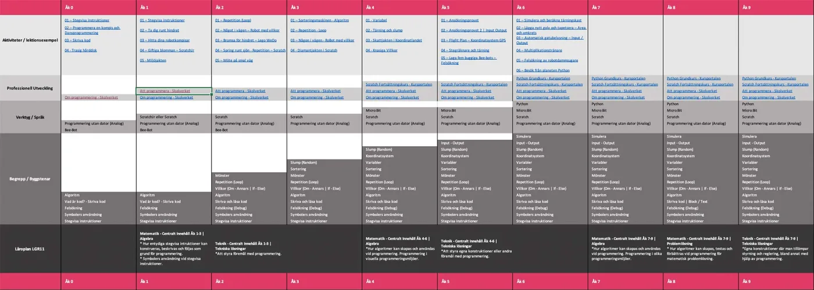

**Om du vill ladda ned hela progressionen som redigerbar excelfil, kan du göra det i länkarna nedan. Eftersom det är ett levande dokument så kommer uppdateringar att göras regelbundet.**

## Hur fungerar progressionen?

Progressionen går från **vänster till höger** gällande årskurserna och **nedifrån upp** i varje årskurs, från vad läroplanen och dess kommentarmaterial säger till det som vi identifierat som **det viktigaste**, det vill säga **begreppen / byggstenarna** för att jobba med programmering. Efter det kommer de verktyg och språk vi jobbar med, länkar till kurser inom professionell utveckling för lärare och längst upp exempelaktiviteter, som är de som du hittar här på sajten.
Det viktiga är begreppen och byggstenarna, det som ska bli elevernas verktygslåda gällande programmering, inte vilket språk vi använder eller vilka verktyg.

## Ladda ned

Progression v 1.4 |  [Excel](/media/doc/xp181-programmering-v1_4.xlsx) | 2020-01-30
Progression v 1.3 |  [Excel](/media/doc/xp181-programmering-v1_3.xlsx) | 2018-12-20
Progression v 1.2 |  [Excel](/media/doc/xp181-programmering-v1_2.xlsx) | 2018-12-13
Progression v 1.1 |  [Excel](/media/doc/xp181-programmering-v1_1.xlsx) | 2018-11-14
Progression v 1.0 |  [Excel](/media/doc/xp181-programmering-v1_0.xlsx) | 2018-11-12
Progression v 0.9 |  [Excel](/media/doc/xp181-programmering-v0_9.xlsx) | 2018-10-20
Progression v 0.8 |  [Excel](/media/doc/xp181-programmering-v0_8.xlsx) | 2018-09-10
